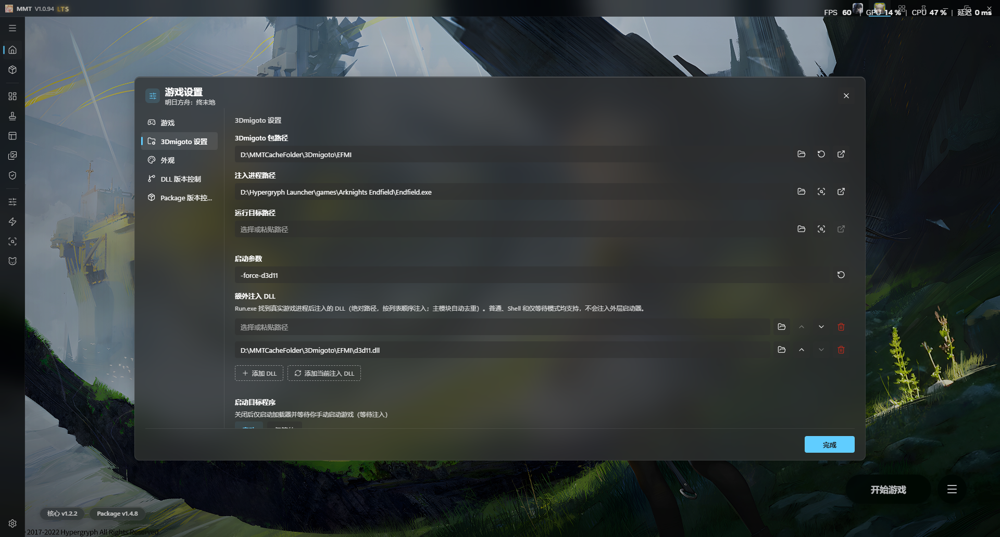
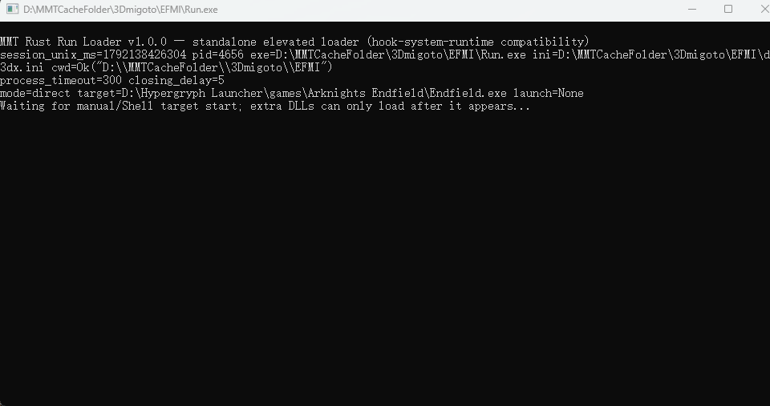
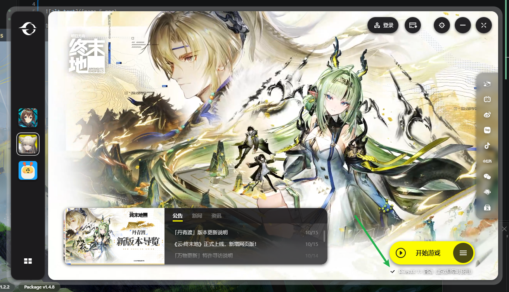
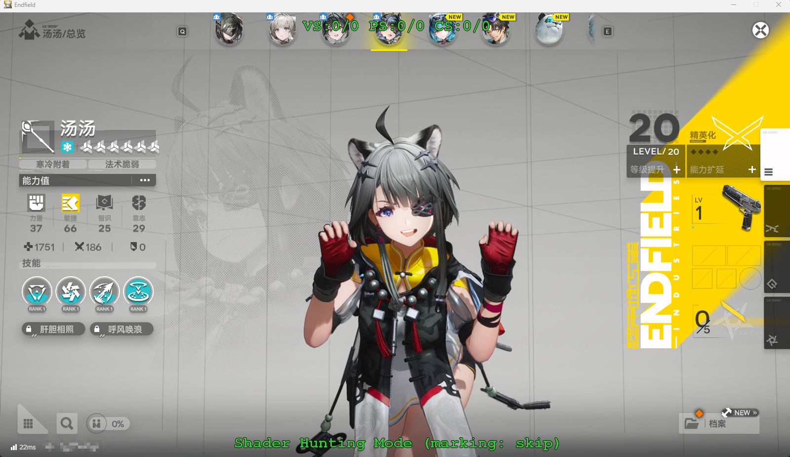

# 如何注入3Dmigoto到终末地

首先确保你使用的是最新版MMT，如图是1.0.94版本

如图所示：
- 注入进程路径选择你自己的`Endfield.exe`
- 运行目标路径空着
- 启动参数填写 `-force-d3d11`
- 额外注入一个dll路径，直接点击 `添加当前注入dll` 按钮自动设置

随后点击开始游戏，出现Run.exe的黑窗口

随后从游戏官方启动器启动游戏即可，记得勾选`使用DirectX 11`。

游戏中小键盘0开启绿字就算成功

