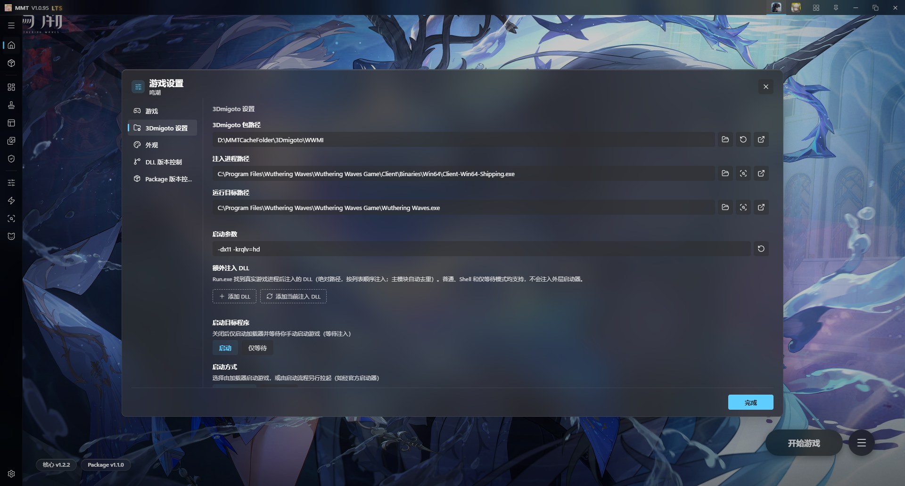

# WWMI

## 启动配置

MMT「游戏设置 → 3DMigoto 设置」中鸣潮的推荐配置如下：



### 注入进程路径

```text
C:\Program Files\Wuthering Waves\Wuthering Waves Game\Client\Binaries\Win64\Client-Win64-Shipping.exe
```

### 运行目标路径

```text
C:\Program Files\Wuthering Waves\Wuthering Waves Game\Wuthering Waves.exe
```

### 启动参数

```text
-dx11 -krqlv=hd
```

## GameBanana

https://gamebanana.com/games/20357

