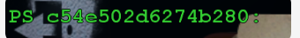

# 🙈 用 `handling = skip` 隐藏东西（PS 篇）

最常被问到的问题之一：**游戏里有一层东西挡着（菜单、遮罩、扫描线、水印、暗角、特效残影），怎么把它藏掉？**

答案就是：找到它用的 **PS Hash**，然后在 ini 里对这个 hash 写一句 `handling = skip`。



上面这张图里，绿字显示的 `PS < c54e502d6274b280:` 就是一串 PS Hash。下面演示完整的流程。

## 🎮 第一步：在绿字界面里选中它

1. 进游戏，按小键盘 `0`（`toggle_hunting`）打开绿字界面，也就是 Hunting 模式。
2. 让要隐藏的东西出现在画面上。
3. 按小键盘 `1` / `2`（`previous_pixelshader` / `next_pixelshader`）轮流切换当前选中的 PS。
   - Hunting 默认 `marking_mode = skip`：**被选中的 PS 会立刻被跳过**，所以切到「那层东西突然消失」的那一个就对了。
4. 画面上会显示类似 `PS < c54e502d6274b280:` 的绿字，这串 16 位小写十六进制就是 **PS Hash**。

> 💡 这里说的都是 `d3dx.ini` 里 `[Hunting]` 段的默认按键，改过就按你自己的来。如果 `marking_mode` 是 `pink` 而不是 `skip`，选中的东西会变成亮粉色，同样能辨认是哪一个。

## 📋 第二步：把 Hash 记下来

两种办法：

- **自动**：按小键盘 `3`（`mark_pixelshader`）标记当前 PS。默认 `marking_actions` 里带了 `clipboard`，Hash 会直接进剪贴板，粘贴出来就是。
- **手动**：把绿字里的 16 位十六进制抄下来（注意是 `0` 不是 `o`，全小写）。

## ✍️ 第三步：写一条 skip

在 Mod 的 ini 里加一段：

```ini
[ShaderOverride_HidePS]
hash = c54e502d6274b280
handling = skip
```

保存后回到游戏按 `F10` 重新加载，那层东西就会消失。

> 💡 段名里的 `HidePS` 只是给人看的，随便起名，只要前缀是 `[ShaderOverride` 就行，同一份 ini 里不要重名。

## 🔍 没生效？按这几点查

| 现象 | 可能原因 | 怎么办 |
| --- | --- | --- |
| 画面完全没变化 | Hash 抄错、段名重复、ini 没被加载 | 看 `d3d11_log.txt` 有没有 `[ShaderOverride_HidePS] handling = skip` |
| 画面没变化，日志也没有 | 这段没被调用，或者条件不成立 | 检查是不是写在别的段里的 `if ... endif` 里面 |
| 消失的东西太多 | 这个 PS 被很多物体共用 | 加条件，见下面「只隐藏一部分」 |
| 位置对但闪烁、错位 | 问题在 VS 而不是 PS | 用同样的方法找 VS Hash（小键盘 `4` / `5`），改用 `hash = <VS Hash>` |
| 只消失了一部分 | 那层东西不止一个 draw | 把剩下的 PS / IB 逐个找出来分别处理 |

## 🎯 只隐藏一部分：给 skip 加条件

PS Hash 只说明「用了哪个着色器」，不说明「画的是哪个物体」。想只藏一部分，就要再加条件。

### 用变量 + 按键开关

```ini
[Constants]
global persist $hide_ui = 1

[Key_HideUI]
key = f6
type = cycle
$hide_ui = 0,1,

[ShaderOverride_HidePS]
hash = c54e502d6274b280
if $hide_ui == 1
  handling = skip
endif
```

这样按 `F6` 就能在「显示 / 隐藏」之间切换，出问题时也能一键切回来对比。

### 用 IB / 纹理再筛一层

先把要限定的那个 IB（或纹理）标一个 `filter_index`，再在 `[ShaderOverride]` 里用 `x = ib`（或 `x = ps-t0`）读回来判断：

```ini
; 给目标 IB 打上标记
[TextureOverride_MenuMark]
hash = 1234abcd
filter_index = 1.0

; 只有当前 draw 用的 IB 是它时，才跳过这个 PS
[ShaderOverride_HidePS]
hash = c54e502d6274b280
x = ib
if x == 1.0
  handling = skip
endif
```

`x` 的取值：没有匹配的 `[TextureOverride]` 是 `0`，匹配到但没写 `filter_index` 是 `1`，写了 `filter_index` 就是那个值。IB Hash 怎么拿，见 [按 IB 隐藏模型或部位](/migoto/HideIB/HideIB)。

### 一次性隐藏一整屏界面

如果要藏的不是一层，而是一整屏菜单（登录界面、结算界面、背包），通常是好几组 shader 一起画出来的：把找到的每个 PS Hash 各写一段，或者集中放进一个 `[CommandList]`，再统一用一个按键开关控制。

## 🧪 实战：隐藏一层挡视线的遮罩

假设目标是游戏里一直贴在屏幕上的暗角（vignette），它会盖住模型，你想截图时不要它：

```ini
[Constants]
global persist $vignette_off = 0

[Key_Vignette]
key = f7
type = cycle
$vignette_off = 0,1,

; 暗角通常是一个全屏 PS，命中的 draw 只有一次
[ShaderOverride_Vignette]
hash = c54e502d6274b280
if $vignette_off == 1
  handling = skip
endif
```

按 `F7` 就能开关它。如果发现关掉暗角之后整体变亮或变灰，说明同一个 PS 还顺带做了别的事（比如色彩校正），那就需要换更细的条件，或者改用别的手段。

## ⚠️ 注意

- **跳过的是一整次 draw。** 共用这个 PS 的所有东西会一起消失，所以先想清楚它是「只画这一层」还是「顺带画了一大片」。
- **逻辑不会被跳过。** 界面隐藏了，按钮通常还能点；判定、音效、AI 都照常跑。
- **Hunting 里的 skip 是临时的。** 退出 Hunting（小键盘 `+` 结束，或再按一次 `0`）就恢复，想永久生效必须写进 ini。
