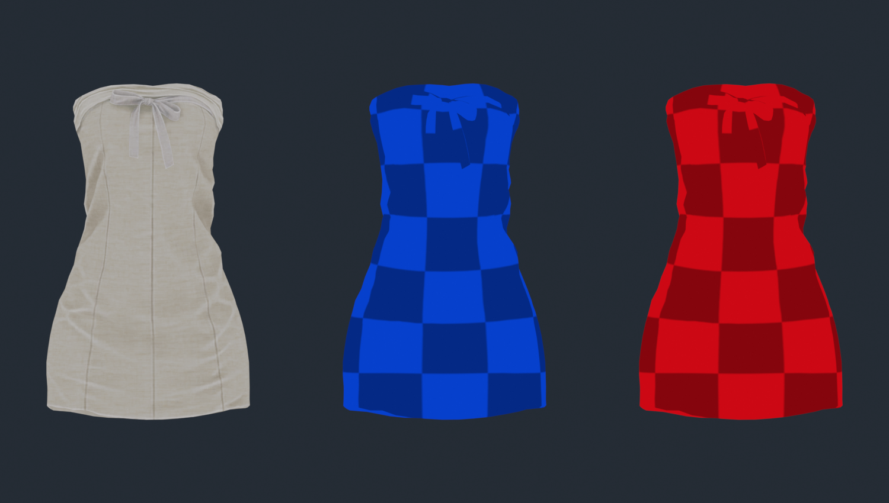
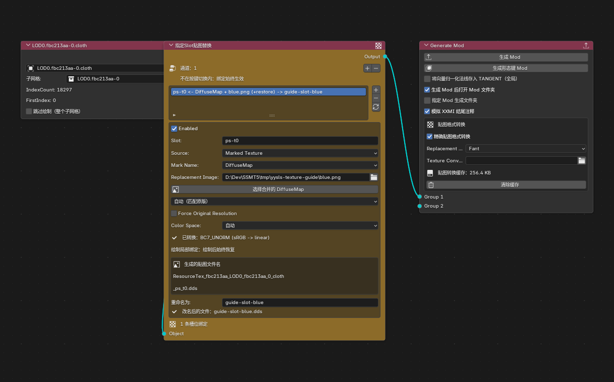
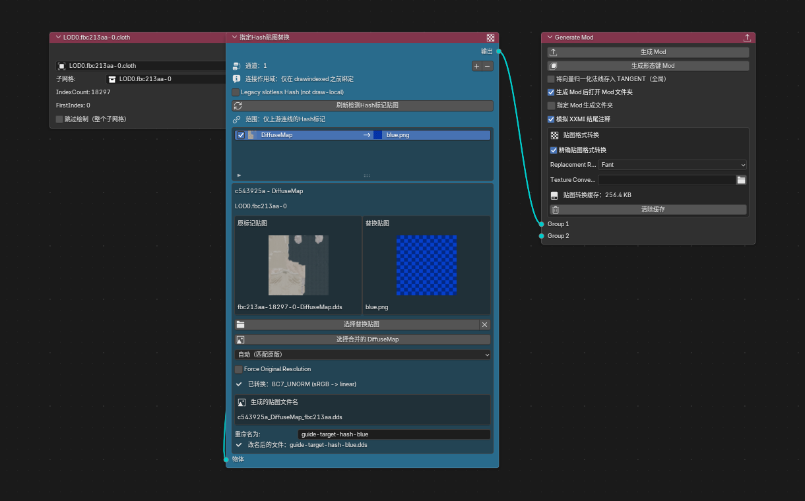
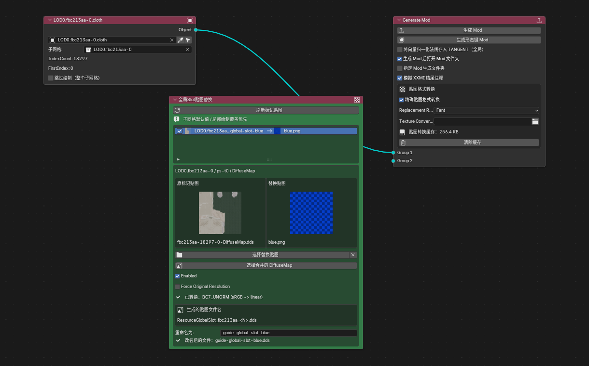
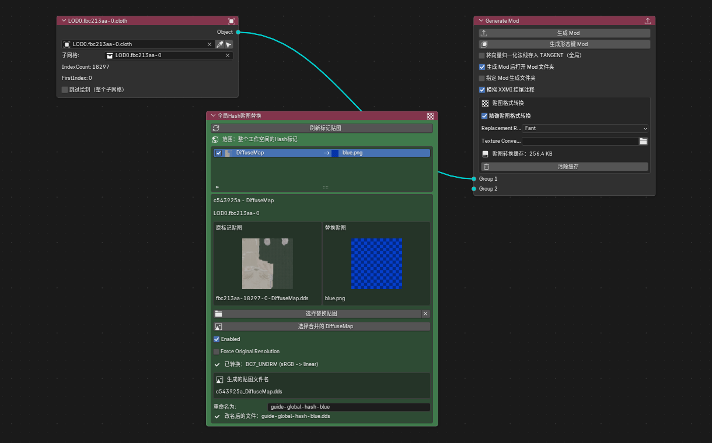
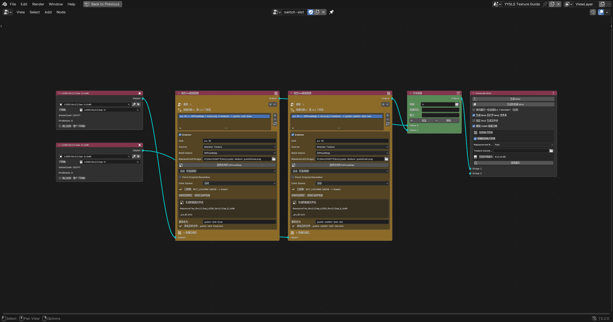

# 四种贴图指定怎么用：以 YYSLS 为例

MIMIBlender 蓝图的 **添加 → 贴图指定** 里有四个容易混淆的节点：

- **指定 Slot 贴图替换**
- **指定 Hash 贴图替换**
- **全局 Slot 贴图替换**
- **全局 Hash 贴图替换**

它们都在换图，区别只有两点：**按什么认图**（槽位还是 Hash），以及**管多大范围**（只改连线的对象，还是整个工作区）。本文用三个真实需求讲清楚怎么连、怎么选图、会影响谁、生成后怎么检查：把一件衣服换成蓝色、按 H 在蓝红之间切换、设一张默认贴图同时给少数对象例外。

::: info 本文实测范围
实测日期：2026-11-08；Blender **5.2.0**，MIMIBlender **1.0.80**。

使用本机 YYSLS 已提取工作区 `NeiYi` 的真实衣服模型、UV 和原贴图。原始标记是 Hash；演示 Slot 时，在**隔离副本**中将同一标记改为 Slot，模型、贴图 Hash 和槽位保持一致。没有修改原工作区，也没有把测试 Mod 安装进游戏。

下方节点图片来自真实 Blender 窗口截图；模型对照图是 Blender UV 渲染示意，**不是 YYSLS 游戏截图**。四种替换、两种按键切换、两组优先级与全局 Hash 停用行为均检查了实际生成的 INI / DDS；没有把游戏内光照、染色、透明效果或客户端兼容性写成已验证。
:::

## 1. 先看效果和选择方式



*左：原图；中：蓝色棋盘诊断图；右：红色棋盘诊断图。三者用同一份真实模型和 UV，棋盘用于确认绑定和 UV，不是成品贴图。*

替换颜色图能改图案、颜色、纹样；想保留原来的褶皱、花纹和透明区域，应当编辑原贴图，而不是用一张纯色图整个盖掉。

### 四种节点的速查表

| 节点 | 如何定位目标 | 要连对象线吗 | 适合什么需求 |
| --- | --- | --- | --- |
| `指定 Slot` | 当前对象绘制前的槽位，如 `ps-t0` | **要**，串在对象到输出的路径中 | 单个对象换图、两个对象用不同图、按键换图 |
| `指定 Hash` | 从连接来源的 Hash 标记取出原图与槽位 | **要** | 已经用 Hash 标记，但只想改连接对象或某个按键状态 |
| `全局 Slot` | 工作区内的 `Submesh + 槽位 + 标记名` | **不需要**，节点没有对象接口 | 多个 Submesh 集中设默认贴图 |
| `全局 Hash` | 原贴图的 Hash | **不需要**，节点没有对象接口 | 所有使用同一 Hash 的地方一起换 |

**口诀：只改指定对象用「指定」；同一 Hash 全部统一用「全局 Hash」；多个 Submesh 设默认用「全局 Slot」。**

::: warning 不要把两对词混为一谈
`Hash / Slot` 是**定位方式**；`指定 / 全局` 是**作用范围**。

尤其是「指定 Hash」不等于「全局 Hash + 对象选择框」：新节点要求能解析出槽位，在对象的 `drawindexed` 前绑定、之后恢复。不要照旧版无槽位 Hash 的教程去理解它。
:::

节点只管生成 Mod 时怎么换，**不会自动帮你转换标记风格**——这一点第 2 章单独说。

## 2. 开始之前：先把原图标记准备正确

节点里能选到哪张图，取决于 MMT 那边给这张图标了什么名、有没有应用；没标记就没得选。

### 2.1 本例的真实数据

- DrawIB `fbc213aa`，子网格 `LOD0.fbc213aa-0`
- 标记 `DiffuseMap`，原工作区风格 **Hash**（Slot 演示副本改成 **Slot**）
- 贴图 `c543925a`（槽位 `ps-t0`），原图 `1024 × 1024`、`BC7_UNORM`
- 替换图 `512 × 512` 蓝、红 PNG

`DrawIB` 不是贴图 Hash。

### 2.2 正常操作的准备顺序

1. MMT 切到 YYSLS，选工作区、LOD，提取模型。
2. 贴图标记页选该子网格的 DrawCall，标记名称填 `DiffuseMap`。
3. 标记风格按要用的节点选（见 2.3）。
4. 点「应用 SubMesh 标记」，状态变「已应用」。
5. 回 Blender 导入，蓝图里放**物体信息**节点，子网格别选错。
6. 准备替换图，先用棋盘确认位置。

### 2.3 标记风格不是节点自动转换的

指定 Slot、全局 Slot 只认 `Slot`、`SharedSlot` 标记；指定 Hash、全局 Hash 只认 `Hash` 标记。

节点只按风格筛选，**不会把 Hash 标记自动转成 Slot 标记**。新建标记默认是 `Hash`，直接点指定 Slot 的自动填充很可能一行都没有——不是节点坏了，回 MMT 改风格再应用即可。

标记改风格后，已配置的旧行不会跟着变：指定 Slot 里那行导出会直接报错，提示去 MMT 标成 Slot / SharedSlot，删掉重填即可。

## 3. 指定 Slot：只给经过节点的对象换图

### 3.1 连线

```text
物体信息（衣服） → 指定 Slot → 生成 Mod
```

把物体信息节点的输出接 **Object**，再把 **Output** 接到生成 Mod。连的是**对象**，不是材质；不接线不生效。



*截图里 Object 输入在节点底部、Output 在右上角。*

### 3.2 按本例操作

1. 添加 **指定 Slot**（添加 → 贴图指定）。
2. 连好 3.1 的线，点**从标记自动填充**（刷新图标）。
3. 选中 `DiffuseMap` 行，确认 Slot 是 `ps-t0`。
4. 来源选 **标记贴图**，**替换图像**选蓝色 PNG。
5. 格式来源 **自动（匹配原版）**、色彩空间 **自动**；**强制原版分辨率**不勾（见 9.2）。
6. **重命名为** `guide-slot-blue`，生成 Mod 后检查 DDS 和 INI。

### 3.3 三种来源

| 来源 | 怎么填 | 用在哪 |
| --- | --- | --- |
| 标记贴图 | 选标记名，替换图像可留空 | 大多数情况 |
| 外部文件 | 手填槽位 + 选图 | 没有 Slot 标记时 |
| 已有 Resource | 填已存在的 `Resource...` 名 | 高级复用 |

`替换图像` 留空不是"空白贴图"：`SharedSlot` 复用共享资源，普通 `Slot` 会给该对象复制一份标记图。

### 3.4 能实现什么效果

只有经过节点的对象换图，其它对象和绘制都不受影响。可以：

- 同一 Submesh 的 A、B 各用一张图；
- 串进按键切换的两个状态（见第 7 章）；
- 多对象共用一套行：`+` 加通道，第 N 通道对应第 N 对 Object / Output。

导出时按「备份 → 绑定替换图 → drawindexed → 还原」写进该对象的绘制，画完自动还原；节点上没有这个开关。

## 4. 指定 Hash：沿用 Hash 标记，局部替换

### 4.1 连线与操作



*刷新后才有行；替换图在详情框里选。*

1. 加 **指定 Hash 贴图替换**，对象接 `Object`、`Output` 接生成 Mod，**先连线再刷新**。
2. 点 **刷新检测 Hash 标记贴图**，得到 `c543925a - DiffuseMap`。
3. 核对原图与 Submesh，点 **选择替换贴图**；`X` 清空。
4. 格式留 **自动（匹配原版）**。
5. 确认替换只写在 `drawindexed` 前后，没有生成全局节。

### 4.2 和指定 Slot 差在哪

| 维度 | 指定 Slot | 指定 Hash |
| --- | --- | --- |
| 匹配依据 | 槽位 `ps-t0`，可手填 | 贴图 Hash，靠刷新得到 |
| 影响范围 | 你填的槽位 | 标记带来的槽位，不能改 |
| 贴图文件名 | `ResourceTex_…_ps_t0.dds` | `c543925a_DiffuseMap….dds` |
| 典型误用 | 猜槽位硬填 | 当全局替换用 |

**结论：两者都只改连接对象；标记是 Hash 风格就用它，要换槽位用 `指定 Slot`。**

### 4.3 清空、停用和旧模式

- **清空**：点 `X` 或取消勾选即撤回局部替换；有全局默认时显示全局那张。
- **静音**：Ctrl+M 会断掉整条对象链，不是只停掉替换。
- **旧模式**：只在标记没有槽位时才开；它按 Hash 条件写 `this = ...`，同一状态的两处绘制分不开。

## 5. 全局 Slot：统一管理 Submesh 的默认图

全局 Slot 是一份「默认图清单」：按 Submesh 登记某层贴图的默认图，这个 Submesh 的绘制都套用。和指定 Slot 的区别是**不连线**，范围只到该 Submesh（见 3.2）。

### 5.1 怎么操作



1. 在本次生成用的蓝图里添加 **全局 Slot 贴图替换**，不连对象线。
2. 点 **刷新标记贴图**，读取工作区已标记的槽位贴图。
3. 选中 `LOD0.fbc213aa-0 / ps-t0 / DiffuseMap`，点 **选择替换贴图** 选图，保持 **启用**。
4. 需要时填 **重命名为** 别名，再生成 Mod。

::: warning
节点要在本次生成的蓝图里、Submesh 要进入导出范围；标记已失效的行要清空或停用，否则导出报错。
:::

### 5.2 能实现什么效果

例：整件衣服 LOD0 的 DiffuseMap 一次换成蓝图；要例外的对象就串指定 Slot（见 3.2）。

- 两个 Submesh 共用一张原图，也能各配各的默认图。
- 会在对应绘制的 `drawindexed` 前后绑定与还原，不是全游戏永久换掉 `ps-t0`。
- 清空替换图或取消 **启用** 即撤回。

**什么时候用**：多个 Submesh 要统一默认图。

## 6. 全局 Hash：同一个贴图 Hash 统一换图



*节点下方：左为原图，右为替换图。*

### 6.1 操作步骤

1. 添加 **全局 Hash**。它按 Hash 生效，没有对象接口，**不接对象线**。
2. 点 **刷新标记贴图**，列出工作空间的 Hash 标记。
3. 选中 `c543925a` 核对原图，选替换图、启用该行。
4. 生成 Mod。

### 6.2 能实现什么效果，以及为什么会"改到别人"

- **效果与原因**：贴图 Hash 在游戏里是共用的，导出只写一条无条件的 `hash` 覆盖，所以所有用到 `c543925a` 的绘制会一起换图。
- **该用它**：希望这张图的所有使用者一起换，例如整套配色。

::: warning 只想改一件
用指定 Slot 或指定 Hash 局部覆盖（见 3.2、4.2）。
:::

确认误伤的办法：在其他 Submesh 的标记和已装 Mod 的 INI 里搜这个 Hash。

### 6.3 停用不完全等于删掉该节点

- **清空或取消启用该行**：设置保留，不再写替换节，DDS 换回原图。
- **静音或删除节点**：都不参与导出；静音留设置，删除丢设置。

要彻底不生效，静音或删掉节点；但标记还在导出范围时，自动导出仍会补一条指向原图的规则。

## 7. 完整案例：按 H 在蓝色和红色之间切换

前提：贴图先在 MMT 标记并应用；节点只决定何时用哪张。

### 7.1 推荐结构

```text
物体信息 A ─ 指定 Slot（蓝） ─ Status 0 ┐
物体信息 B ─ 指定 Slot（红） ─ Status 1 ┴→ 开关按键 h ─ 生成 Mod
```



A、B 是同一个模型，不用复制几何体。

### 7.2 逐步设置

1. 两个 **物体信息**（同衣服、同 Submesh）各接 **指定 Slot**，确认 `ps-t0`。
2. **替换图**：上蓝下红；`重命名为` 可留空。
3. 加 **开关按键**，**添加** 一次得到 `Status 0` / `Status 1`，**按键** 填 `h`。
4. 蓝路径接 `Status 0`、红路径接 `Status 1`，输出接 **生成 Mod**，生成后核对 DDS。

导出为 `key = h`、`type = cycle`、`$swapkey0 = 0,1`；这一步未进游戏实测。

### 7.3 三种常见错误

| 现象 | 原因 | 怎么改 |
| --- | --- | --- |
| 按 H 两个状态同一张图 | 只有一个替换节点，且在开关下游 | 每个状态一个替换节点，分别接 `Status 0` / `1` |
| 换图无效 | 替换图留空，复用了标记原图 | 每条路径各选一张图 |
| 报 Hash 重复 | 两个 **全局 Hash** 各写一条，它没有状态接口 | 改用 **指定 Slot** |

## 8. 完整案例：全局设红图，指定对象例外用蓝图

### 8.1 Slot 组合

1. **全局 Slot** 刷新，选 `ps-t0 / DiffuseMap`，填红图。
2. 衣服对象 → **指定 Slot**，自动填同一行，填蓝图；其余绘制只有红图。
3. 局部行排在全局行后面、`drawindexed` 前面，所以能覆盖。

### 8.2 Hash 组合

1. **全局 Hash** 刷新，选 `c543925a`，填红图。
2. 衣服对象 → **指定 Hash**，选同一行，填蓝图；它只在这件绘制里绑定并还原，别的同 Hash 对象仍用红图。
3. 没有 Slot 标记、想按原图统一规则时才选 Hash 组合。

对比：只有 Slot 组合能锁住单个对象；Hash 组合的全局那半按 Hash 生效。

## 9. 格式、颜色空间与文件名

### 9.1 先自动匹配格式

- 默认 **自动（匹配原版）**：输出原图格式，沿用 alpha / mip。
- 解析不到原图，先查标记和子网格（见 2.3）；真拿不到才手填格式和槽位。
- 颜色空间留 **自动**：带 `normal`、`mask` 等字样的按数据图处理，不做 gamma。

### 9.2 分辨率够用即可

- 不勾 **强制原分辨率** 时输出保持替换图尺寸，勾了才缩到原尺寸。
- 判断标准：看它在游戏里占多大、离多远，够用即可；再大只增体积和加载时间。

::: warning 本机实测
勾选后 512→1024 报 `FAILED [resize] (80004005)`；先在图片编辑器里做好尺寸再导出。
:::

### 9.3 重命名只改导出文件名

- `重命名为` 只改 `Textures` 里的文件名，不改 Hash、槽位和作用范围。
- 来源是"已有 Resource"时没有文件可改名；改名也解决不了资源节冲突。

### 9.4 什么不能靠这四个节点保证

- **UV**：不修 UV，也不判断哪张图进哪个槽位；UV 错了换图只会更明显。
- **贴图内容**：带 Alpha 不等于会透明或镂空（还看 Shader、槽位、状态）；颜色图不会变成发光或金属。
- **别的 Mod**：不管其它 Mod 或 MMT 自动标记导出是否改同一个 Hash / 槽位；颜色被抢走先查谁最后绑定。
- **LOD**：LOD0 生效不代表其他 LOD 生效。

## 10. 出问题时按这个顺序检查

1. **标记**：DrawCall 有标记、风格对得上、原 DDS 已同步；刷新仍为空就查工作区 / LOD / TYPE，标记已失效就清掉重配。
2. **连线**：物体信息 → 节点 → 生成 Mod 连通，全局节点在同一个蓝图里。
3. **槽位**：报 `no resolvable slot` = 标记没捕获到槽位，补带槽位的标记，别开旧版无槽位 Hash；报上游未解析 = 上游物体信息没设 Submesh。
4. **格式**：先自动匹配原版；`FAILED [resize]` 就关掉强制原分辨率、用已经备好的尺寸；颜色图不加 gamma，法线 / Mask 更不能加。
5. **范围**：只有全局 Hash 会按 Hash 改到别的 Submesh / LOD；Slot 忘了还原也会漏。
6. **别处**：停用后颜色还在，查全局默认、MMT 自动导出的 Hash 节、别的 Mod 的同 Hash 节。
7. **游戏端**：蓝图已绑、INI 已加载、Hash / 槽位匹配当前绘制；换了捕获或版本就得重配。

## 11. 生成后怎么验收

1. **产物**：报错时别把旧 Mod 当这次成功；INI、缓冲、替换 DDS 齐全，`filename` 都有对应文件，尺寸 / 格式也对。
2. **作用点**：Slot 节点紧贴 `drawindexed` 且有备份 / 还原；全局 Hash 是 `hash = c543925a` + `this = ...` 的独立节；按键两分支两张 DDS。
3. **进游戏**：单独装这一个 Mod，看目标对象、拉远看 LOD、按 `H` 切换、再看共用这张图的其它对象；预览和 INI 检查不能代替进游戏。
4. **回退**：停用或移出测试 Mod，按 `F10` 重载确认回到原图；停用一行不算卸载。

### 本次实际核验清单

| 核验项 | 结论 |
| --- | --- |
| 四种节点 | 4 / 4 成功，引用闭合 |
| 指定 Slot / 指定 Hash 的 H 双状态 | 两分支两张 DDS，局部绑定与还原 |
| 全局 Slot + 指定 Slot | 先全局后局部，逆序还原 |
| 全局 Hash + 指定 Hash | 全局节与局部资源分离 |
| 停用全局 Hash 行 | 原 DDS 与捕获原图 SHA-256 一致 |
| 强制原分辨率（Fant / Linear） | 失败：resize `80004005` |
| 游戏内视觉 / H 键 / 全部 LOD | **未验证** |

## 12. 相关教程

- [蓝图实现按键开关和按键切换](../SwitchAndToggle/SwitchAndToggle)：H 键双状态的完整写法。
- [贴图格式导致色差问题](/migoto/TextureFormatProblem/TextureFormatProblem)：色差先看这篇。
