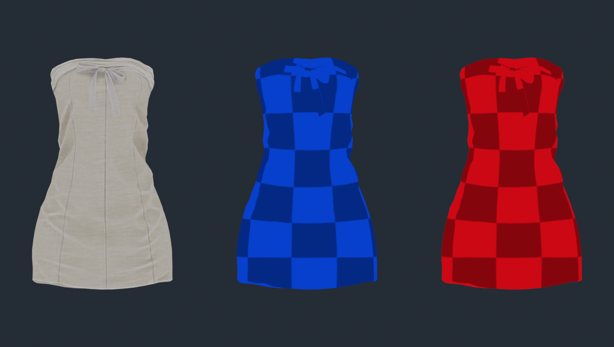
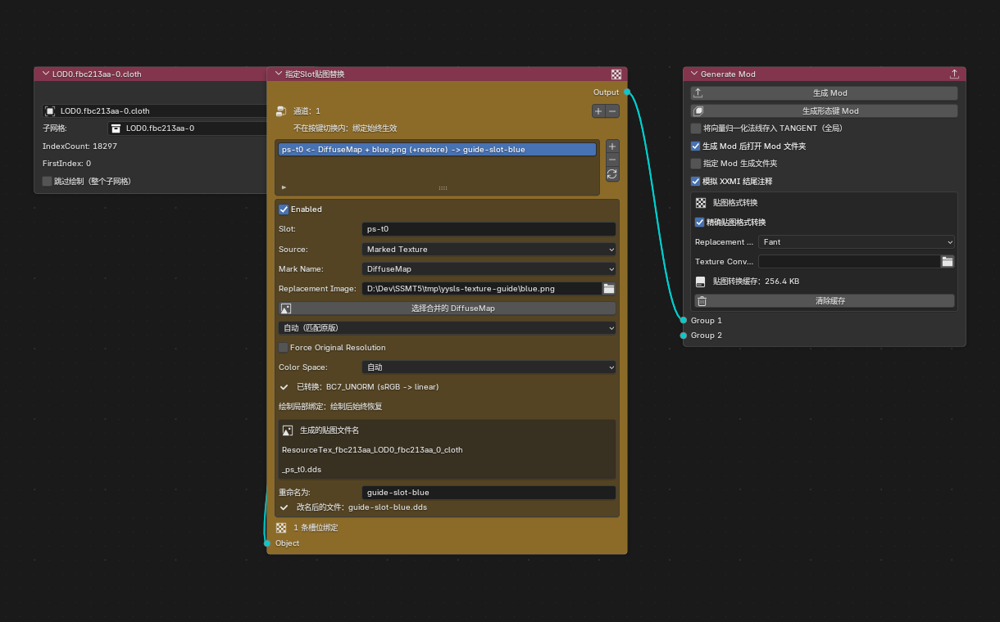
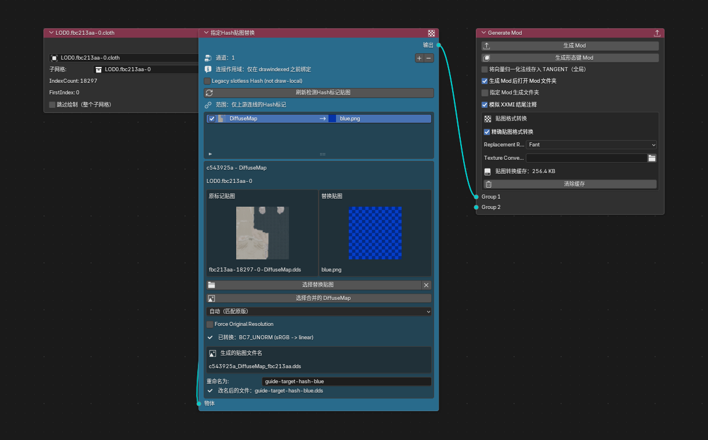
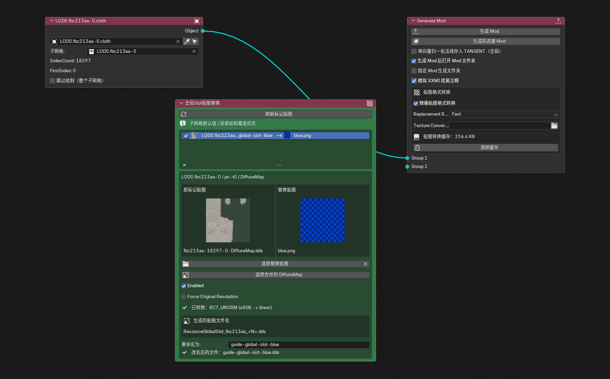
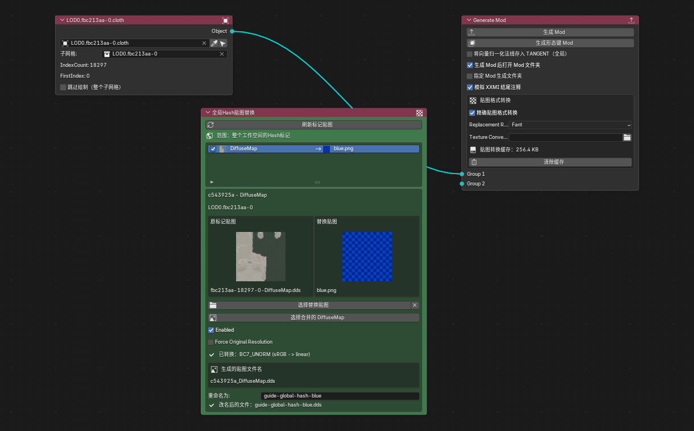
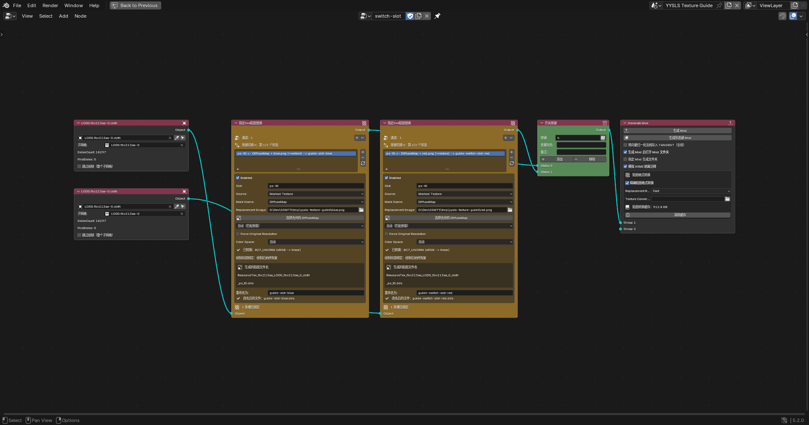

# 四种贴图指定怎么用：以 YYSLS 为例

MIMIBlender 蓝图的 **添加 → 贴图指定** 中，有四个容易混淆的节点：

- **指定 Slot 贴图替换**
- **指定 Hash 贴图替换**
- **全局 Slot 贴图替换**
- **全局 Hash 贴图替换**

本文从「把一件衣服换成蓝色」「按 H 在蓝色和红色之间切换」「设置默认贴图，同时给少数对象例外」三个需求出发，说明如何连线、如何选图、会影响谁，以及怎么检查生成结果。

::: info 本文实测范围
实测日期：2026-11-08；Blender **5.2.0**，MIMIBlender **1.0.80**。

使用本机 YYSLS 已提取工作区 `NeiYi` 的真实衣服模型、UV 和原贴图。原始标记是 Hash；演示 Slot 时，在**隔离副本**中将同一标记改为 Slot，模型、贴图 Hash 和槽位保持一致。没有修改原工作区，也没有把测试 Mod 安装进游戏。

下方节点图片来自真实 Blender 窗口截图；模型对照图是 Blender UV 渲染示意，**不是 YYSLS 游戏截图**。四种替换、两种按键切换、两组优先级与全局 Hash 停用行为均检查了实际生成的 INI / DDS；没有将游戏内光照、染色、透明效果或当前客户端兼容性写成已验证。
:::

## 1. 先看效果和选择方式



*左：原图；中：蓝色棋盘诊断图；右：红色棋盘诊断图。三者使用相同的真实模型和 UV；采用简化材质显示贴图，不模拟游戏着色器。棋盘用于确认绑定和 UV，不是成品衣服贴图。*

替换颜色图可以改变图案、颜色、纹样等；如果希望保留原来的褶皱、花纹和透明区域，应当编辑原贴图，而不是用一张纯色图完全盖掉它。

### 四种节点的速查表

| 节点 | 如何定位目标 | 要连对象线吗 | 适合什么需求 | 范围边界 |
| --- | --- | --- | --- | --- |
| 指定 Slot | 当前对象绘制前的槽位，如 `ps-t0` | **要**，串在对象到输出的路径中 | 单个对象换图、两个对象不同图、按键换图 | 只为经过节点的对象绑定；建议开启绘制后恢复 |
| 指定 Hash | 从连接来源的 Hash 标记获取原图与槽位 | **要** | 已经使用 Hash 标记，但只想改连接对象或某个按键状态 | **当前版本默认是绘制局部替换**，不是全游戏 Hash 替换 |
| 全局 Slot | 工作区内 `Submesh + 槽位 + 标记名` | **不需要**，节点没有对象接口 | 集中管理多个 Submesh 的默认贴图 | 「全局」指工作区管理范围；实际绑定仍在对应 Submesh 的绘制中 |
| 全局 Hash | 原贴图的 Hash | **不需要**，节点没有对象接口 | 所有使用同一 Hash 的地方统一换图 | 加载该 Mod 时，凡匹配此 Hash 的位置都有可能被影响 |

**选择口诀：只改指定对象，用“指定”；同一 Hash 全部统一，用“全局 Hash”；多个 Submesh 集中设默认，用“全局 Slot”。**

::: warning 不要把两对词混为一谈
`Hash / Slot` 是定位与标记方式；`指定 / 全局` 是管理与作用范围。

尤其是 **“指定 Hash”不等于“全局 Hash + 对象选择框”**。1.0.80 的新节点默认要求能解析槽位，在对象的 `drawindexed` 前绑定、之后恢复。不要照旧版无槽位 Hash 的教程理解它。
:::

## 2. 开始之前：先把原图标记准备正确

### 2.1 本例的真实数据

| 字段 | 本例值 | 是什么 |
| --- | --- | --- |
| DrawIB | `fbc213aa` | 衣服的 Index Buffer Hash，**不是贴图 Hash** |
| Blender 子网格 | `LOD0.fbc213aa-0` | 此次 LOD0 的子网格 |
| IndexCount / FirstIndex | `18297 / 0` | 当前子网格绘制范围 |
| 标记名 | `DiffuseMap` | 给贴图角色起的名字，不是 Shader 反射结论 |
| 贴图 Hash | `c543925a` | 原贴图的标识 |
| 标记槽位 | `ps-t0` | 当前捕获绘制中的 Pixel Shader 贴图槽位 |
| 原图 | `1024 × 1024`，`BC7_UNORM` | 本例 DDS 实际尺寸与格式 |
| 演示替换图 | `512 × 512` 的蓝 / 红 PNG | 辨认状态用的诊断图 |

**这些值只是本例，不要直接拿去套另一套衣服、另一帧或另一个 LOD。** `ps-t0` 也不是 YYSLS 所有对象都固定使用的颜色槽位。

### 2.2 正常操作的准备顺序

1. 在 MMT 中切换到 YYSLS，选择要制作的工作区和 LOD，提取对应模型。
2. 在贴图标记页面选择**该子网格对应的 DrawCall**，确认原图和槽位，再标记为 `DiffuseMap` 等合适名字。
3. 准备使用 Slot 节点时，标记风格用 **Slot / SharedSlot**；使用 Hash 节点时，标记风格用 **Hash**。
4. 重新同步 / 提取标记数据，使模型声明中的标记和原 DDS 可用，再在 Blender 导入工作区。
5. 检查对象信息节点的**对象名和子网格**。对象可以改名，子网格仍要指向正确的源数据。
6. 准备替换图，先用容易辨认的颜色或棋盘测试；成功后换成成品图。

本文为了让四个节点使用同一份可比数据，Slot 案例使用工作区副本。日常使用请通过 MMT 标记界面设置风格，**不需要照本文去手改 JSON**。

### 2.3 标记风格不是节点自动转换的

- 指定 Slot 的「从标记自动填充」只接收 Slot / SharedSlot 标记。
- 两种 Hash 节点刷新时读取 Hash 标记。
- 全局 Slot 刷新时读取当前工作区选中 TYPE 的 Slot / SharedSlot 标记。
- 看不到标记时，先检查风格、连接来源、子网格、LOD 和导入 TYPE，不要反复乱填 Hash。

## 3. 指定 Slot：只给经过节点的对象换图

### 3.1 连线

```text
对象信息（衣服） → 指定 Slot 贴图替换 → 生成 Mod
```

对象列表或对象组也可以作为来源。关键不是“摆在旁边”，而是**对象的输出经过它，最后能到达生成 Mod 节点**。



### 3.2 按本例操作

1. 在蓝图中添加 **指定 Slot 贴图替换**。
2. 先连好上面的对象路径，再点绑定列表旁的**刷新 / 自动填充**按钮。
3. 选中 `DiffuseMap` 行，确认槽位被填成 `ps-t0`。
4. 来源保留 **标记贴图（Marked Texture）**。
5. 在 **替换图像（Replacement Image）** 选择蓝色 PNG。
6. 格式先选 **自动（匹配原版）**，颜色空间先保留 **自动**。
7. 本例不勾选 **强制原分辨率**，因此输出保持替换图的 `512 × 512`。
8. 开启 **绘制后恢复（Restore After Draw）**，避免后续绘制意外沿用这张图。
9. 可在 **重命名为** 输入 `guide-slot-blue`；后缀由输出格式决定，本例实际输出 `guide-slot-blue.dds`。
10. 点击**生成 Mod**，检查导出目录和 INI。

### 3.3 三种来源分别怎么用

| 来源 | 怎么填写 | 适用情况 |
| --- | --- | --- |
| 标记贴图 | 选择上游子网格的标记；可另选本对象的替换图 | **优先推荐**。能沿用捕获的槽位与格式信息 |
| 外部文件 | 手填槽位，选择图片文件 | 已知准确槽位，或没有合适的 Slot 标记 |
| 已有资源 | 填已有的 `Resource...` 节名 | 高级复用；资源必须确实定义，不能只写一个不存在的名字 |

标记来源的「替换图像」留空，表示复用该子网格的标记图；**不是“换成空白贴图”**。要给同一个 Submesh 的两个对象不同图，应该给各自节点填写不同的替换图像。

### 3.4 能实现什么效果

- 只把衣服 A 换成蓝图，其他没有经过节点的对象不做这次局部绑定。
- 同一 Submesh 下的 A、B 使用不同的图片。
- 串入按键切换分支，给同一个模型的不同状态指定不同图。
- 用节点顶部 `+` 增加通道，将多个对象路径经过同一套绑定行；**输入 N 配输出 N，所有通道共享这些行**。

「绘制后恢复」很重要：本例实际导出结构如下（省略其他缓冲和着色器配置）：

```ini
; 为此次绘制备份进入槽位的资源
ResourceTex_fbc213aa_LOD0_fbc213aa_0_cloth_ps_t0_Bak_0 = ref ps-t0
ps-t0 = ResourceTex_fbc213aa_LOD0_fbc213aa_0_cloth_ps_t0
drawindexed = 18297,0,0
ps-t0 = ResourceTex_fbc213aa_LOD0_fbc213aa_0_cloth_ps_t0_Bak_0
```

不开恢复时，槽位绑定有可能继续影响后续绘制，不能将“指定”理解为天然没有状态泄漏。

## 4. 指定 Hash：沿用 Hash 标记，但按连接对象局部替换

### 4.1 连线与操作

```text
对象信息（衣服） → 指定 Hash 贴图替换 → 生成 Mod
```



1. 添加 **指定 Hash 贴图替换**，先连好对象和输出。
2. 点击 **刷新检测 Hash 标记贴图**。本例检测到 `c543925a - DiffuseMap`。
3. 选中该行，看左侧原图是否是目标贴图，来源是否属于正确 Submesh。
4. 在 **选择替换贴图** 中选蓝色 PNG，保持该行启用。
5. 格式保留自动匹配原版；按需设置输出文件名。
6. **不要开启 `Legacy slotless Hash (not draw-local)`**，除非确实在维护需要旧行为的蓝图。
7. 生成 Mod，检查替换位于对象绘制命令里，而不是出现全局 `this = ...` 替换。

### 4.2 它和指定 Slot 到底差在哪

两者在本例都能让连接衣服使用蓝图，但配置入口不同：

- 指定 Slot 显式编辑槽位与来源，可以手填文件 / 资源。
- 指定 Hash 提供 Hash 标记列表与原图预览，刷新范围由连接来源决定。
- 指定 Hash 默认从标记中解析槽位；本例解析为 `ps-t0`，**自动备份并绘制后恢复**。
- 两者对同一个对象的同一槽位重复声明局部替换，会冲突；不要叠两个节点来“提高优先级”。

本例实际导出：

```ini
ResourceTex_fbc213aa_LOD0_fbc213aa_0_cloth_hashc543925a_LocalBackup = ref ps-t0
ps-t0 = ResourceTex_fbc213aa_LOD0_fbc213aa_0_cloth_hashc543925a
drawindexed = 18297,0,0
ps-t0 = ResourceTex_fbc213aa_LOD0_fbc213aa_0_cloth_hashc543925a_LocalBackup
```

**没有**为这个局部案例生成 `[TextureOverride_Texture_c543925a]` 的全局替换节。

### 4.3 清空、停用和旧模式

当前默认的有槽位指定 Hash 中，清空替换图或停用该行表示撤回**局部替换**；如果另外设置了全局默认，对象仍可能显示全局默认，而不是强制恢复游戏原图。

旧版无槽位模式走按 Hash 条件替换的路径，不能保证两个同状态绘制互相隔离。新教程、按键局部换图优先使用默认有槽位模式。

## 5. 全局 Slot：统一管理 Submesh 的默认图

### 5.1 不需要连对象线

```text
对象信息（衣服） ─────────────→ 生成 Mod

全局 Slot 贴图替换（独立放在同一蓝图中）
```



1. 在当前用于生成的蓝图中添加 **全局 Slot 贴图替换**。
2. 点 **刷新标记贴图**，读取当前工作区的 Slot / SharedSlot 标记。
3. 选中 `LOD0.fbc213aa-0 / ps-t0 / DiffuseMap`。
4. 选择蓝色替换图，保持该行启用。
5. 按需设置文件别名；本例为 `guide-global-slot-blue`。
6. 正常保留对象到生成 Mod 的连线，再生成。

::: warning “不需要连线”不是“不需要生成路径”
节点必须属于这次生成使用的蓝图（或其被处理的组）；放在另一个无关蓝图中不会参与本次生成。全局 Slot 只是默认管理器；要实际替换模型绘制，相关 Submesh 仍须进入导出。
:::

### 5.2 能实现什么效果

适合在一个列表里集中设置衣服、饰品等多个 Submesh 的默认图片，不必在每个对象路径上放一个替换节点。

- 同一 Submesh 的相关绘制使用该行默认图。
- 同一贴图 Hash 被不同 Submesh 使用时，可以给它们不同的 Slot 默认图；**不会按 Hash 将它们强行合并**。
- 想给某个对象例外时，在该对象路径串入指定 Slot / 默认有槽位指定 Hash。
- 清空或停用全局 Slot 行只撤回这层默认绑定，并不会额外输出一个全游戏恢复原图命令。

本例实际执行：

```ini
ResourceGlobalSlot_fbc213aa_0_Backup = ref ps-t0
ps-t0 = ResourceGlobalSlot_fbc213aa_0
drawindexed = 18297,0,0
ps-t0 = ResourceGlobalSlot_fbc213aa_0_Backup
```

它绑定在对应绘制里，执行结束会恢复进入这层之前的资源。因此，“全局 Slot”**不是把全游戏的 `ps-t0` 永久改成一张图**。

## 6. 全局 Hash：同一个贴图 Hash 统一换图



### 6.1 操作步骤

1. 在生成蓝图中添加 **全局 Hash 贴图替换**，不接对象线。
2. 点 **刷新标记贴图**，读取整个当前工作区的 Hash 标记。
3. 选中 `c543925a - DiffuseMap`，核对原图。
4. 选择蓝色替换图、保持启用，按需设置输出名称。
5. 在生成 Mod 节点执行生成。

本例实际生成的是：

```ini
[ResourceHashGlobal_c543925a]
filename = Textures\guide-global-hash-blue.dds

[TextureOverride_Texture_c543925a]
hash = c543925a
match_priority = 0
this = ResourceHashGlobal_c543925a
```

### 6.2 能实现什么效果，以及为什么会“改到别人”

这个节点按照 Hash 统一替换，适合同一原图在多个地方共享、且确实希望它们一起变化的需求。

但**扫描列表来自当前工作区，不代表游戏作用范围只限当前工作区**。另一个服装、角色或 LOD 如果也使用同一 Hash，都可能被这条规则影响。它不会根据 Blender 中选中了哪个对象限制作用范围，也不会自动限定某个按键状态。

若要「别人继续用默认图，仅某件衣服换成另一张」，使用全局 Hash 加指定 Hash 局部覆盖，或直接只做指定替换。

### 6.3 停用不完全等于删掉该节点

对已刷新、有原图来源的全局 Hash 行，停用 / 清空替换按当前实现会使用可用的原 DDS 来恢复该 Hash 的原图；不能一律理解成“不输出规则”。本次停用实测导出的原 DDS 与捕获原图 **SHA-256 一致**。

这与全局 Slot 的“撤回默认绑定”不同，也与默认有槽位指定 Hash 的“撤回局部替换”不同。若需要彻底撤回该管理器，静音对应节点；同时确认 MMT 自动 Hash 标记导出和其他 Mod 没有另一个替换规则。

## 7. 完整案例：按 H 在蓝色和红色之间切换

### 7.1 推荐结构

```text
对象信息 A（同一件衣服） → 指定替换：蓝图 → 开关按键 Status 0 ┐
                                                            ├→ 输出 → 生成 Mod
对象信息 B（同一件衣服） → 指定替换：红图 → 开关按键 Status 1 ┘
```

**A、B 是两个对象信息节点，引用同一个模型；不是一定要复制两份几何体。**



### 7.2 逐步设置

1. 放两个对象信息节点，均选中同一衣服对象、同一 Submesh。
2. 每个路径放一个 **指定 Slot** 节点并自动填充标记。
3. 第一条路径的替换图像选蓝 PNG，第二条路径选红 PNG。
4. 两边都开启绘制后恢复，分别设置不同输出别名。
5. 添加 **开关按键（Switch Key）**，点一次添加按钮，使其有 `Status 0`、`Status 1` 两个输入。
6. 蓝图输出接 `Status 0`，红图输出接 `Status 1`；按键填 `h`。
7. 开关输出接生成 Mod，生成后核对两张 DDS 和两个条件分支。

本例两种「指定」节点都做了双状态导出验证；如果使用指定 Hash，两边刷新 Hash 标记、选不同图，并保持旧版无槽位模式关闭即可。

实际生成的切换配置包括：

```ini
[KeySwap_0]
condition = $mod_visible == 1
key = h
type = cycle
$swapkey0 = 0,1
```

绘制列表中，`$swapkey0 == 0` 分支绑定蓝图，`$swapkey0 == 1` 分支绑定红图，每个分支各有一次 `drawindexed`。这证明导出形成了双状态换图规则；**本次没有进入游戏实际按 H，不将它写成按键游戏实测通过**。

### 7.3 三种常见错误

- **只在开关之后放一个替换节点：** 两个状态都经过同一套行，无法表达蓝 / 红不同图。
- **两边的替换图像都留空：** 两边复用同一个标记原图，看起来没有切换。
- **用两个全局 Hash 节点分别填蓝 / 红：** 它们没有状态接口，同一个 Hash 默认重复声明可能冲突，不是按键切换。

## 8. 完整案例：全局设红图，指定对象例外用蓝图

### 8.1 Slot 组合

- 全局 Slot 中给对应 Submesh 设置红图。
- 衣服对象路径经过指定 Slot，选择蓝图。
- 其他没有局部覆盖的对应绘制继续使用全局默认。

本例实测顺序为：

```text
备份进入资源 → 绑定全局红图
  → 备份全局红图 → 绑定局部蓝图 → drawindexed
  → 恢复全局红图
→ 恢复进入资源
```

**局部覆盖之所以赢，不是因为节点摆得更靠右，而是实际绑定顺序更靠近该对象的绘制。**

### 8.2 Hash 组合

- 全局 Hash 对 `c543925a` 设红图。
- 指定 Hash 对连接衣服设蓝图，并解析到 `ps-t0`。
- 导出保留全局红图的 Hash 节，以及独立蓝图资源、局部绑定和恢复。

本次核验两张图使用**不同资源名和不同输出文件**，没有发生最后拷贝的图片把另一张覆盖掉的情况。游戏里的其他相同 Hash 使用者仍可能受全局红图影响。

## 9. 格式、颜色空间与文件名

### 9.1 推荐先自动匹配

- 本例原 DDS 是 `BC7_UNORM`，蓝 / 红 PNG 经过转换后也是 `BC7_UNORM`。
- **自动匹配原版**依赖可解析的捕获原图。找不到原图时，不应假装能自动推导正确格式。
- 外部文件来源需要手填槽位；确实无法解析原图时，才能按实际需求手动指定格式。
- 原图是 UNORM 不表示颜色图片一定要按线性输入解释；输入颜色空间与输出 DXGI 格式是两件事。本例界面显示 `sRGB → linear`，并不能由此推出所有 YYSLS 贴图都要这样处理。
- 普通颜色图先保留自动；法线、Mask 等数据图不要随意做 gamma 转换。

### 9.2 分辨率不是越大越好

默认不强制原分辨率时，本例 `512 × 512` PNG 成功输出为 `512 × 512` DDS；强制原分辨率的设计意图是按照捕获原图尺寸缩放。

::: warning 本机实测限制：强制原分辨率缩放失败
本机将 `512 × 512` PNG 强制缩放到捕获的 `1024 × 1024` 时，texconv 返回 `exit 1`，错误为 `FAILED [resize] (80004005)`；Fant 与 Linear 两种滤波尝试都失败。

因此本文的成功案例**没有勾选该选项**，不将强制缩放列为实测成功功能。遇到相同错误，可先在图片编辑器中准备所需分辨率的图，再关闭强制缩放导出；这是一条规避建议，不是本次已验证修复。不要只切换滤波器就宣称问题解决。
:::

### 9.3 重命名只改导出文件名

“重命名为”不会改变命中的原贴图 Hash、槽位或作用范围。本例用了 `guide-...` 别名，便于在 `Textures` 目录中检查。

已有资源来源没有新文件可以重命名；不要通过文件别名解决资源节冲突。蓝 / 红图应有可区分的输出，最终以生成 INI 的 `filename` 为准。

### 9.4 什么不能靠这四个节点保证

- 不会替你重新绘制 UV、修复错误 UV 或自动给所有材质选择正确通道。
- 不会因为图片里有 Alpha 就保证游戏出现透明或镂空；还取决于游戏 Shader、对应槽位与绘制状态。
- 颜色图替换不能自动得到发光、金属、布料染色等特定效果；相关贴图角色须另行核对。
- Blender 材质里临时换图，不等于已经配置好蓝图导出；反过来，蓝图绑定也不等于视口材质立刻自动换图。
- LOD0 成功不代表其他 LOD 已覆盖；如果切远镜头恢复原图，应逐个检查其他 LOD 的来源和导出路径。

## 10. 出问题时按这个顺序检查

| 现象 | 先检查什么 |
| --- | --- |
| Slot 自动填充没有行 | 是否是 Slot / SharedSlot 标记；上游对象的 Submesh 是否正确 |
| 指定 Hash 没有行 | 是否是 Hash 标记；是否**先连上游对象**再刷新 |
| 全局列表没有行 | 当前工作区、LOD / TYPE 选择是否一致；标记和原 DDS 是否已经同步 |
| 节点设置了却不生效 | 指定节点输出是否到生成 Mod；是否生成了另一个蓝图 |
| 指定 Hash 报没有可解析槽位 | 标记是否有捕获槽位；重新同步标记；不要为绕过错误随便打开旧模式 |
| 只改一件衣服却改到别人 | 是否用了全局 Hash；是否共享同一 Hash；Slot 是否忘了绘制后恢复 |
| 按键能换模型，颜色不换 | 两条状态是否真的用了不同的替换图像；替换是否错误地放在开关之后 |
| 提示同槽位重复绑定 | 同一对象是否同时用了指定 Slot 和指定 Hash；保留一个局部来源 |
| 刷新后提示失效标记 | 源标记 / TYPE 是否变化；重新核对、清空或停用旧行，别忽略失效配置 |
| 导出缩放报 `FAILED [resize]` | 先关闭强制原分辨率，用已经准备好的图片尺寸；见本机限制说明 |
| 停用了局部替换却仍然有颜色 | 全局默认、MMT 自动标记导出或其他 Mod 是否还在生效 |
| Blender 看起来变了，游戏没变 | 蓝图是否绑定、INI 是否加载、槽位 / Hash 是否匹配当前游戏绘制 |

## 11. 生成后怎么验收

1. **看生成消息。** 报错或文件转换失败时，不要把已有旧 Mod 当成这次生成成功。
2. **看文件。** 本例四种导出都有 INI、索引 / 顶点缓冲和实际 DDS，资源文件引用闭合，没有缺失引用文件。
3. **看尺寸与格式。** 本例成功替换图为 `512 × 512 / BC7_UNORM`。
4. **看作用点。** 两种默认「指定」和全局 Slot 绑定靠近对象的 `drawindexed`；全局 Hash 出现 `hash = c543925a / this = ...`。
5. **看按键分支。** 双状态应有两个条件和两张不同图片；不是只有一条无条件替换。
6. **最后才进游戏验收。** 单独加载测试 Mod，核对目标对象、近远 LOD、H 键切换、其他共享对象；记录原状与替换后的截图。这一步不能被 Blender 预览或 INI 检查代替。

### 本次实际核验清单

| 案例 | 结果 |
| --- | --- |
| 指定 Slot / 指定 Hash / 全局 Slot / 全局 Hash | 4 / 4 原生生成成功，DDS 和 INI 引用检查通过 |
| 指定 Slot 蓝 / 红 H 键双状态 | 两个条件分支、两张独立 DDS 通过 |
| 指定 Hash 蓝 / 红 H 键双状态 | 两个条件分支、局部绑定与恢复通过 |
| 全局 Slot 红 + 指定 Slot 蓝 | 全局先绑定、局部后覆盖、逆序恢复通过 |
| 全局 Hash 红 + 指定 Hash 蓝 | 全局规则与局部蓝图资源分离通过 |
| 停用全局 Hash 行 | 输出原 DDS 与捕获原图字节 Hash 一致 |
| 强制原分辨率，Fant / Linear | **失败**：texconv resize `80004005`，保留限制说明 |
| 游戏内视觉、H 键响应、全部 LOD | **本次未验证** |

[查看本次核验摘要（JSON）](/guides/yysls-texture-assignment/verification.json)。摘要记录版本、导出片段、尺寸 / 格式和 Hash，不附带游戏模型、缓冲或可直接安装的整套 Mod。

## 12. 相关教程

- [蓝图实现按键开关和按键切换](../SwitchAndToggle/SwitchAndToggle.md)
- [贴图格式导致色差问题](/migoto/TextureFormatProblem/TextureFormatProblem)

本文依据 MIMIBlender `1.0.80`、提交 `e2bf917bd30b4119eeea39b54496f87d407237cb` 的实际节点与 YYSLS 原生导出结果编写；以后节点行为变化时，应重新实测，尤其不要将旧版无槽位 Hash 的范围说明直接搬到新节点上。
