# 贴图标记：给贴图登记身份，再生成 Mod

「贴图标记」是 MMT 里把"模型的贴图"变成"能在游戏里替换的 Mod"的那一步。这篇文档从头到尾讲一遍这个页面：左边是什么、中间怎么挑、右边按钮点下去会发生什么，最后怎么生成一个能进游戏的贴图 Mod。

截图来自 MMT 1.0.165 + 一份真实的提取结果（下面是 8 位哈希值随便举的例子，你机器上的数字会不同，但位置和顺序一样）。

---

## 1. 页面总览与前置条件

「贴图标记」在左侧导航里，排在「工作台」下面。它夹在两条流程中间：先在工作台（或一键逆向）把模型从游戏里提取出来，到这里给贴图起名字、打标记，再去 MIMIBlender 导入编辑，最后回来生成 Mod。

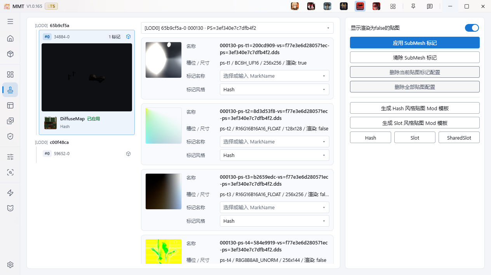

为什么不能跳过这一步，直接拿张新图丢进游戏？因为 3Dmigoto 认贴图靠的是**贴图 hash** 或它绑定的**像素槽位**，生成的 ini 里没有对应的声明，你丢进去的 dds 就是一张没人认识的文件。Blender 那边也一样，插件按标记名（会写进复制出去的 `<SubMesh>-<MarkName>.dds` 文件名）把贴图认回材质。

所以这一页干的事是：**先给贴图登记身份**，不是改图本身。

### 页面分成哪几块

三列布局：左边 SubMesh 列表，中间贴图列表，右边一整列操作按钮。

- **左侧 SubMesh 列表**：按 DrawIB 分组，每行是一个能单独标记的 SubMesh。点中某行，行内就地展开 3D 预览和这个 SubMesh 已有的标记。这一列管"选对象、看结果"。
- **中间贴图列表**：一次显示一个 DrawCall 的贴图，用顶部下拉切换。每张图给缩略图、名称、槽位/尺寸，再往下是「标记名称」和「标记风格」。这一列管"哪张图、叫什么名"。
- **右侧操作按钮区**：应用标记、清除标记、删除配置、生成模板都在这里，最上面还有「显示渲染为false的贴图」开关。
- **弹出层**：贴图右上角的九宫格按钮弹出「RGBA 四通道预览」；「标记名称」下拉底部的「新建自定义名称」会弹一个填名字的对话框。两个都是浮层，关掉不丢数据。

### 进来之前要满足什么

三件事缺一不可：

1. **已经提取完成一个模型**。贴图列表读的是工作区里提取时留下的贴图记录，不是现场扫游戏。
2. **工作台里有对应的 LOD 标签页**。页面按当前工作区的标签页挨个读 SubMesh，这里不提供新建工作区的入口。
3. **游戏预选是你要做的那个游戏**。页面没有自己的游戏选择器，预设选错，看到的就是别人的工作区，或者全空。

没满足时：右下角会提示「未检测到当前工作空间，无法加载 SubMesh 列表」；工作区里查不到提取结果会提示「当前工作空间下的所有 LOD 中都未找到贴图标记提取结果」；什么都没选时中间显示「还没有可标记的贴图」。

::: tip
第二次做同一个角色会轻松些：完整提取结束时会按历史自动套用你上次的标记，进来就有一部分贴图已经是「已应用」。
:::

### 名词小词典

| 名词 | 一句话解释 |
| --- | --- |
| DrawIB | 游戏一次绘制用的索引缓冲，相当于"一个模型 / 一组部件"的身份，网格和贴图都挂在它下面。 |
| SubMesh | 一个 DrawIB 里被 IndexCount 和 FirstIndex 圈出来的一段索引，就是模型上一个能单独标记的小块。 |
| DrawCall | 游戏真正执行的一次绘制；同一个 SubMesh 可能被多个 DrawCall 用不同贴图画出来。 |
| 贴图标记（MarkName） | 你给一张贴图起的名字，比如 `DiffuseMap`；它决定贴图复制出去的文件名，也决定 Mod 模板长什么样。 |
| 3Dmigoto | 游戏用的注入式 Mod 框架，靠 ini 里的 Hash、槽位规则替换模型和贴图。 |

---

## 2. SubMesh 列表怎么读

左边这一列不是平铺清单，而是一棵树：一个 DrawIB 占一行组头，组里缩进挂着它的各个组件。

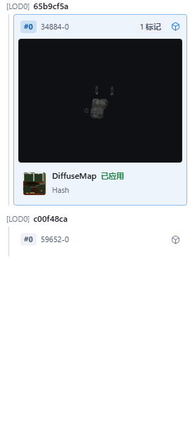

### 组头：DrawIB 与别名

组头那行是这条 DrawIB 的身份牌。如果你给这条 DrawIB 配过别名（比如角色名），这里优先显示别名，原来的哈希退成后面的灰色小字；鼠标停在组头上，会显示「别名 · 哈希」两段。没起过别名就直接显示哈希。

同一个模型拆成好几个 DrawIB 是正常现象：游戏是按 Draw 分开画的，每次绘制各绑一份 IB，身体、头发可能各占一份。组多不代表你提取错了——但每组有自己的贴图，别把 A 组的贴图标到 B 组上。

### 组内的 `#0` `#1` `#2` 从哪来

一个 DrawIB 在提取时会被拆成多个 SubMesh，每个组件占一行，行首就是 `#0`、`#1`、`#2`……

**这个号不是你手动编的，也改不了。** 提取完成后，工具按文件夹名收集这个 DrawIB 下的所有组件，按 FirstIndex 从小到大排序，再从 0 开始依次编号，结果写进工作区里的 `DrawIB-Component.json`。所以 `#0` 永远是 FirstIndex 最小的那一段；序号只说明"在这份 IB 里谁排在前面"，跟渲染先后、材质好坏都没关系。

::: tip
如果某一行前面没有 `#序号`，而是直接显示一整条 `[LOD0] xxx-0` 这样的标签，说明这个 SubMesh 没被写进 `DrawIB-Component.json`。工具在缺这份文件时会按提取出来的文件夹重建一次。
:::

### `#0` 后面那串 `34884-0`

这是 SubMesh 文件夹名的后两段，格式是 `IndexCount-FirstIndex`：IndexCount = 34884，FirstIndex = 0。鼠标停在上面，会提示 `IndexCount 34884 · FirstIndex 0`。

它的分量比看上去重：这两个数就是 3Dmigoto INI 里 `match_index_count` / `match_first_index` 的取值，也就是这群三角形在游戏那份 IB 里的起止位置。**这是这个 SubMesh 在游戏里的定位身份**，后面生成模板、写 INI 靠的就是这两个数，不是你起的名字。

### 右边的「1 标记」和立方体

行右侧的 `1 标记` 是计数：这个 SubMesh 上已经打了几个贴图标记。没打过标记就不显示。

最右边的立方体是常驻提示：**每一行都是一个能预览的 3D 模型**。点这一行，它下面就会展开这个 SubMesh 的 3D 预览。

### 点一行之后会发生什么

点一行就是选中它，同时展开。展开区分成上下两块：

1. 上面是这个 SubMesh 的 3D 预览，用来确认"我选中的是不是这块"；
2. 下面是它已经标记过的贴图列表，每条显示缩略图、标记名、`已应用` / `未应用` 状态，以及这条标记用的风格。点缩略图看大图，点整条会把右侧切回这条标记所在的 DrawCall。

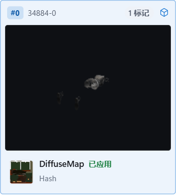

同一个 SubMesh 里如果有两条标记起了同一个名字，这几条会多出一个红色的「冲突」字样（第 7 节讲怎么处理）。

点别的行就直接切过去，展开内容跟着换；想收起就选别的行，没有"再点一次折叠"这回事。

### 组头前面的 `[LOD0]`

方括号里是标签页名，默认就是 `LOD0`、`LOD1`……只开了一页也会照样显示 `[LOD0]`，别以为带方括号就一定是多 LOD。开到多页时，列表里可能同时出现 `[LOD0] 衣服` 和 `[LOD1] 衣服`：名字一样，但属于不同 LOD，组件、索引范围、贴图标记各管各的。

::: warning
组是按「标签页 + DrawIB」划分的。动手之前先看清组头方括号，不然很容易把该标在 LOD0 的贴图标到 LOD1 上。
:::

---

## 3. SubMesh 的 3D 预览与数据类型

### 先看长相，再动手标记

点中一个 SubMesh，它那一行下方会展开预览面板。预览只干一件事：打标记前先确认"这份几何长得对不对、贴图贴上去对不对"。标记最终会落进 `<工作区>/<SubMesh>/TYPE_xxx/`，类型选错就是对着坏几何把整套标记打完，进游戏才发现模型是烂的。

### 3D 视口怎么操作

- 左键按住拖动：旋转。
- 滚轮：缩放，朝鼠标指的位置推进，不是居中放大。
- 不能平移，想看背面就继续转。

鼠标不动时模型会自己慢慢转，一上手就停。模型是实体着色：没贴图时每个部件一种分区色，贴上 DiffuseMap 就显示贴图本身的颜色。这里没有线框、平滑着色的开关。

预览不可用时，面板里会显示一行灰字：

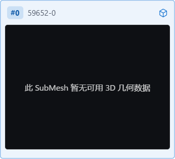

通常是那套类型的文件夹缺东西：没有 SubMeshJson、没有位置缓冲、没有索引缓冲，或者缓冲解不出来。先换一套数据类型看看；每套都这样就不是筛选的问题，是提取失败，回去重提这个 SubMesh。

### 数据类型是什么

「数据类型」（SubMeshJson 里叫 WorkGameType）说的是顶点数据里每个字段按什么顺序、什么格式排。不同游戏、甚至同一游戏的不同角色，顶点布局都不一样，所以同一个 SubMesh 可能提出好几套，每套一个 `TYPE_` 文件夹。

- 下拉显示 WorkGameType 名（形如 `GPU_P12_N12_...`），取不到就用文件夹名去掉 `TYPE_`。
- **只有两套以上才出现下拉和 UV 控件**；只有一套时整块筛选区不渲染，别照着别人的截图找下拉框。
- 换一套类型，预览和 UV 都会重新读。

本篇截图的这份提取结果只有一套数据类型，所以你看不到那个下拉框——这是正常的，不是功能缺失。

### 怎么判断哪一套对

- **看形状**：网格炸开、顶点拉成尖刺、面片乱穿，说明位置字段读错了偏移。
- **看 UV**：线框该是规整三角形、基本落在 0–1 框内；糊成一团或散到框外，就是 UV 读错了。
- **两套的顶点记录长度（stride）一样时**，形状可能"看着还行"，错的是 UV——两个都得看。

::: tip
拿不准就先别点删除，切着下拉比 UV。这一两分钟，比后面重标一整套便宜。
:::

### 「仅保留该数据类型（删除其它）」与「删除数据类型」

下拉右边那个蓝色对勾，提示原文是「仅保留该数据类型（删除其它）」。它把其余几套的 `TYPE_` 文件夹移入回收站，此后只认当前这套；只剩一套时筛选区整体收起，只留 3D 预览。确认框会写明：其余 N 个数据类型的 TYPE 文件夹（含已应用标记）将被移入回收站。

::: warning 这不是「确定」，是删除
- 图标像确认键，干的却是删数据。
- 连文件夹里**已经打好的标记贴图**一起走。
- 进的是回收站，但界面上没有撤销，刷新后就看不到了。先确认再点。
:::

红色垃圾桶删的是**当前下拉选中的这一套**，同样要二次确认，也是移入回收站。

### UV 面板

UV 面板同样只在多套数据类型时出现，位置在 3D 预览上方。

- **UV 层下拉**：一个模型可能有多层 UV，直接列 `TEXCOORD0`、`TEXCOORD1`……0 一般是主 UV（贴 DiffuseMap 的那层），1 常常是光照贴图或细节层。换层时模型和 UV 图一起切。
- **四象限 / 单象限按钮**：默认四象限（原点居中，−1~1，能看出 UV 有没有跑出框），点一下切成单象限（只看 0–1 贴图范围）。切换会重置缩放。
- 图里可拖动平移、滚轮缩放。

绿色三角线框是这块 SubMesh 的 UV 展开；能取到 DiffuseMap 时底下还垫着贴图——这就是核对"贴图有没有落在正确 UV 区域"的地方，也是判断数据类型最直接的一招：类型错时模型可能勉强能看，UV 一定是乱的。

---

## 4. DrawCall 与贴图列表

中间这块区域只回答一件事：左侧选中的这个 SubMesh，在游戏里用了哪几张贴图、各自贴在哪。答案不是一个清单，而是每个 DrawCall 一个清单。

### 先搞清楚为什么要选 DrawCall

游戏画一个 SubMesh 不是一口气画完的。同一个部位常常分几次绘制，每次的着色器或材质参数不同，这样的一次绘制调用就叫一个 DrawCall。常见的是本体画一遍、描边画一遍、透明或自发光层再画一遍，各用各的贴图。

所以第一步是确定"看哪一次绘制"。下拉选错，下面列的是另一轮绘制用的贴图，后面起的标记名也会落到错误的槽位上。它不报错，只是默默改错地方，最难查。

### 顶部下拉里那一串是什么


选中后长这样：

`[LOD0] 65b9cf5a-0 000130 · PS=3ef340e7c7dfb4f2`

- `[LOD0]`：来自哪个 LOD 标签页，和左侧列表一致；对不上就不是同一个 SubMesh。
- `65b9cf5a-0`：DrawIB 加组件号，这个 SubMesh 的身份。
- `000130`：DrawCall 号，一次绘制在抓帧日志里的编号。
- `PS=` 后面：这一轮用的像素着色器（pixel shader，逐个像素跑的那段程序）hash。同一个 DrawCall 号在日志里可能挂着不止一个 PS hash，下拉里会全部列出、用逗号隔开。

两点容易懵：下拉只列出**确有贴图**的 DrawCall，抓帧里画过但没 dump 到贴图的不进列表；第一次进页面会自动选中贴图最多的那个，在 SubMesh 之间来回切会记住你上次的选择。

### 过滤与滚轮切换

下拉可以输入过滤：点开后直接敲 `LOD0`、DrawIB、组件号或 DrawCall 号都能筛。

鼠标停在下拉框上滚滚轮，切上一个／下一个 DrawCall，到头会绕回去。只在那一小块上滚才有效（在贴图列表里滚是滚列表），下拉展开或有浮层盖住它时不生效；只剩一个 DrawCall 时没反应也正常。

### 一张贴图卡片上有什么

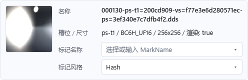

左侧是缩略图，从工作区 `DedupedTextures` 里的 DDS 解出来，解不出来就留空。

`名称` 是 DDS 文件名，也就是抓帧日志里那张贴图的原始名字：

`000130-ps-t1=200cd909-vs=f77e3e6d280571ec-ps=3ef340e7c7dfb4f2.dds`

- `000130`：DrawCall 号，补到 6 位，和上面下拉里那个号对得上（少数旧产物是 3 位）。
- `ps-t1`：`ps` 是像素着色器阶段，`t1` 是第 1 个纹理槽。
- 第一个 `=` 后面 8 位 `200cd909`：这张贴图内容的 hash，同一个 hash 就是同一张图。
- `-vs=` / `-ps=` 各接 16 位：这次 dump 绑定的顶点／像素着色器 hash，`-vs=` 段有时不出现。
- `.dds`：DirectDraw Surface，游戏里贴图的容器格式。

`槽位 / 尺寸` 一行形如 `ps-t1 / BC6H_UF16 / 256x256 / 渲染: true`：

- `ps-t1`：这张图绑在像素着色器的第几个纹理槽上，同一个 DrawCall 里槽位不重复。
- `BC6H_UF16`：DDS 的像素格式。`BC7_UNORM` 是 8 位高质量块压缩、带 alpha；`BC6H_UF16` 是给 HDR 用的块压缩、没有 alpha；`R8G8B8A8_UNORM` 是每通道 8 位、没压缩。
- `256x256`：宽×高。**它量的是缩略图，最长边封顶 256**，所以 2K／4K 的贴图也会显示成 256x256。
- `渲染: true`：这一轮真的用它画了东西；`false` 表示只记到了槽位绑定、没拿到绘制数据。两种默认都列出来，右侧开关可以只留 true 的。

鼠标移到卡片上，右上角才浮出两个按钮：田字格是「查看 RGBA 四通道灰度图」，眼睛是「在 DedupedTextures 中定位该文件」（打开资源管理器并选中那个 DDS）。

### RGBA 四通道预览

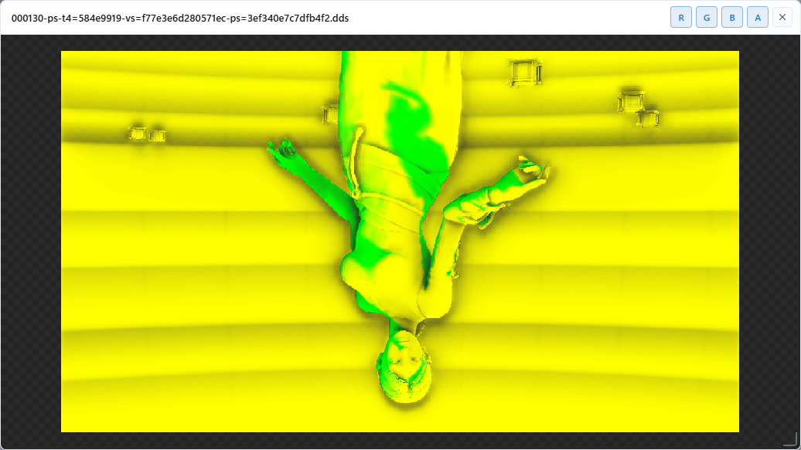

图上按住拖动是平移，滚轮是缩放；右下角的手柄，拖动或滚轮改的是浮窗本身的大小，改完会记住；点浮窗外或右上角 X 关闭。

`R` `G` `B` `A` 是通道开关，默认全开，也就是原图。关掉哪个通道就把它清零；只留 `A` 时按透明度画成灰度，只留一个颜色通道时整图由该通道的亮度决定。

用处：贴图打包的常见习惯是法线图把有效信息放在 `G`、粗糙度／金属度塞在 `B`、透明度放在 `A`。缩略图看着一片灰或一片黑时，切到单通道就能判断这张图到底有没有数据、在哪个通道，不用去开别的软件。

### 没贴图时的空状态

中间显示「还没有可标记的贴图」，只有两种原因：一是还没选 SubMesh 或 DrawCall；二是 DrawCall 选了，但工作区里确实没有它的贴图。

第二种多半不是页面坏了：可能模型提取出来了、贴图没跟着提取，或者那次抓帧没 dump 到。先去工作区的 `DedupedTextures` 里确认有没有对应的 DDS。

---

## 5. 给贴图起标记名（MarkName）

### 标记名称到底是什么

贴图卡片上的「名称」是它在 DedupedTextures 里的文件身份，通常是一长串带哈希的 DDS 名。**标记名称**是另一个东西：贴给这张图的用途标签，只回答"这张图在材质里当什么用"。

读它的是 MIMIBlender 插件。标记应用后，名字作为 `MarkName` 写进该 SubMesh 的 SubMeshJson 的 `TextureMarkUpInfoList`（同项还有 `MarkHash`、`MarkSlot`），插件导入时按它决定接到哪个材质输入。名字还会进复制出的文件名 `<SubMesh>-<MarkName>.dds`，打错不是"没生效"，是插件按名字找不到东西。

::: info 一句话
标记名称是路由标签，贴图本体不改名。
:::

### 下拉里有哪些名字

点开「标记名称」下拉，候选分三块：**内置预设**（跟游戏预设走，不能删）、**自定义名称**（带「自定义」角标，按预设分别记忆）、底部常驻的「＋ 新建自定义名称」。

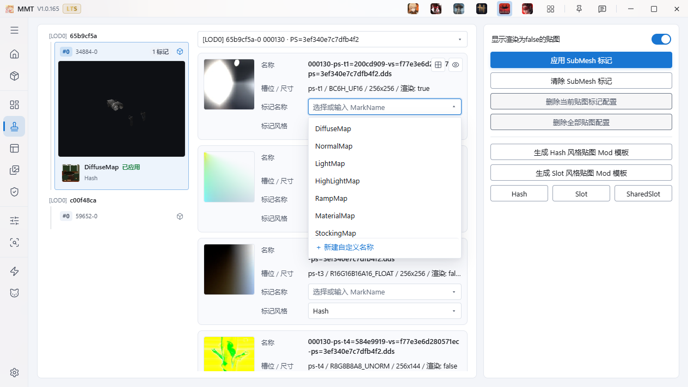

内置列表按预设不同（要加名字就走自定义）：

| 预设 | 内置标记名称 |
| --- | --- |
| Default / Naraka | DiffuseMap、NormalMap、LightMap、HighLightMap、RampMap、MaterialMap、StockingMap |
| SRMI | DiffuseMap、NormalMap、MaterialMap、MaskMap、LightMap、EmissionMap、RampMap |
| GIMI | DiffuseMap、NormalMap、FaceSDFMap、FaceShadow、LightMap、HighLightMap、MetalMap、MaterialMap、StockingMap、NatlanGlow、NatlanTattoo |
| HIMI | DiffuseMap、NormalMap、LightMap、FaceMap、HairMap、MaskMap、RampMap |
| ZZMI | DiffuseMap、NormalMap、LightMap、BodyMaskMap、HairLightMap、MaterialMap、RampMap、StockingMap、GlowGradient、GlowMap、GlowMap2、GlowMap3、WengineFx、WengineFx2、WengineFx3 |
| ZZMIDX12 | DiffuseMap、NormalMap、LightMap、BodyMaskMap、HairLightMap、MaterialMap、RampMap |

### 怎么选

- 点开后直接在框里打字过滤，过滤不会新建名字。
- 回车选当前列表的**第一个匹配项**；都不匹配时显示「无匹配项」，回车没反应。
- 点行也能选中；Esc 收起，没输完的文字会被丢弃。

### 新建自定义名称

点底部「＋ 新建自定义名称」，弹出标题「新建自定义标记名称」的对话框，提示原文：

> 输入名称后点击「新建自定义名称」即可加入下拉列表（按当前游戏预设记忆），并应用到当前贴图。

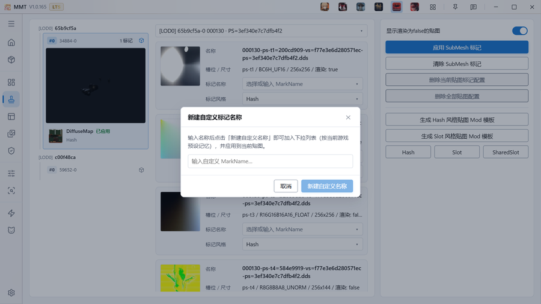

输入框占位「输入自定义 MarkName…」，最多 60 个字符，非空时按钮才可点，回车等于点它。建完进当前预设的自定义列表，立刻套到这张贴图上。

重名不重复建：与内置名或已有自定义名相同（忽略大小写和首尾空格）时直接选中它，提示「该名称已存在，已直接使用」。

### 删除自定义名称

只有自定义项右侧才有 ✕（提示「删除自定义标记名称」），内置项没有。

删除只动"名称选项"这份记忆：已填在贴图行上的名字、已写进 `TextureMarkUpInfoList` 的标记、已复制出去的贴图都不受影响。删掉后这行仍留着这个名字，只是下拉里没得挑。

::: warning
没有二次确认，点错就没了，只能重新新建同名。
:::

### 取消已经打上的标记

只有这一行标记名称非空时，下拉右边才出现小垃圾桶（提示「取消贴图标记」）。点一下清空这行的标记名称，回到没选状态，同样触发自动保存。

### 选完之后发生了什么

选完不用点保存：约 250 毫秒后写进当前 SubMesh 的标记记忆，离开页面时立刻落盘。记忆按 PS Hash 存，同一 SubMesh 里 PS Hash 相同的其它 DrawCall 会带出同一个名字——"我什么都没动怎么就有冲突"多半来自这里。

填了名字还没应用，左侧抽屉里这张贴图显示「未应用」；什么时候变「已应用」，第 7 节讲。

### 为什么有的贴图旁边多一个通道选择器

标记名称选成 `FaceSDFMap` 时（只有它，`NormalMap` 没有），下拉右边多一个小选择器，提示「面部 SDF 通道」，默认 `R`，可切 `R`/`G`/`B`/`A`。Naraka 这类没有 `FaceSDFMap` 的预设不会出现这个控件。

这类图不是彩色贴图，真正的数据只塞在某个通道里，Blender 端得知道取哪个通道才用得对。选择随应用写进 `TextureMarkUpInfoList` 的 `FaceSDFChannel`。

### 常见误区

- **同一 SubMesh 里一个标记名只能有一份。** 第二张也选 `DiffuseMap`，左侧两条都会标红「冲突」。比较忽略大小写和首尾空格，`diffusemap` 与 `DiffuseMap` 算同一个。给第二张换个名即可：`DiffuseMap2`。
- **别用中文名或空格。** 代码只做两件事：去首尾空格、限 60 字符，没有别的校验。但名字会进文件名，建议只用英文字母数字，跟内置写法一致。
- **改名不等于改已应用的结果。** 应用过再改名会回到「未应用」，要重新应用才写进 SubMeshJson。

---

## 6. 三种标记风格：Hash、Slot、SharedSlot

每张贴图卡片上，标记名下面还有一行「标记风格」，三个选项：`Hash`、`Slot`、`SharedSlot`。它不决定你选哪张图，只决定**生成的 Mod 怎么把这张图换上去**。选错了 Mod 照样出得来，但进游戏可能没反应，也可能把别处一起换了。

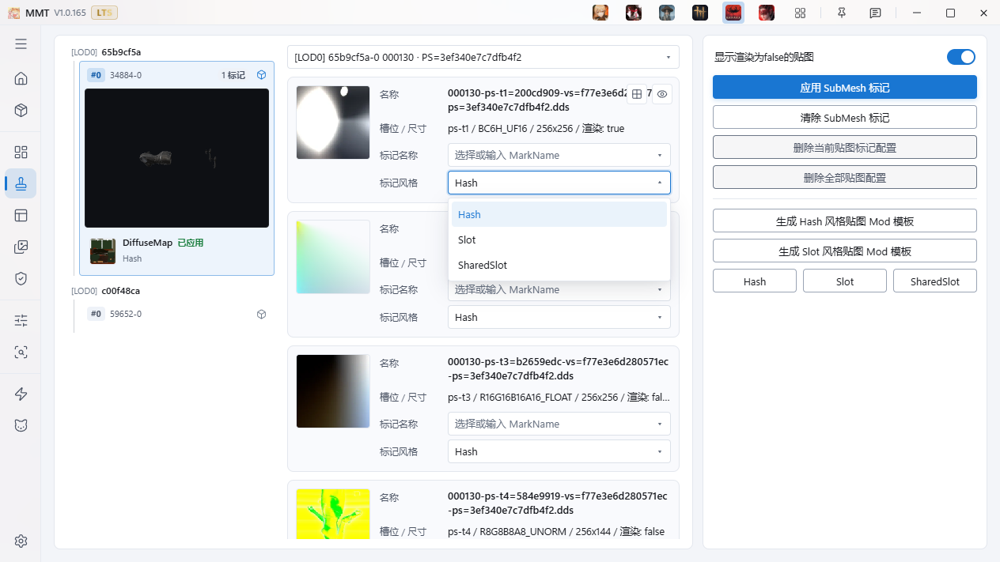

### 先记住一句话：hash 认图，槽位认位置

游戏每帧把贴图绑到像素着色器的槽位上。`ps-t0` 拆开看：`ps` 是像素着色器，`t` 表示纹理，`0` 是第几号槽。同一个 `ps-t0`，这一帧挂脸，下一帧挂衣服，位置本身不认图。

3Dmigoto 因此有两条拦路：

- **认位置（槽位）**：不管这个槽现在挂的是谁，直接换成我的图，写法就是 `ps-t0 = ResourceXxx`。
- **认图（hash）**：每张贴图有一个 8 位十六进制指纹，抓帧时就写在文件名里，第一个 `=` 后面那 8 位就是它。

按 hash 替换还有个容易忽略的前提：**按 hash 的段不会自己运行**。必须有 `checktextureoverride`（下称 CTO）在某个槽上问一句"这里现在绑的是谁"，3Dmigoto 才会拿这个 hash 去找对应的段。CTO 是这类段唯一的触发方式，把 Hash 模板里那几行 CTO 删了，替换就不生效。

### Hash 风格

一次导出生成一个 `<DrawIB>_TextureMod.ini`，结构是固定的三段：

```ini
[TextureOverride_IB_SlotCheck]
hash = 65b9cf5a
match_priority = 0
checktextureoverride = ps-t8

[TextureOverride_Texture_6339b684]
hash = 6339b684
this = ResourceTexture_6339b684

[ResourceTexture_6339b684]
filename = DiffuseMap_6339b684_6339b684-BC7_UNORM_SRGB.dds
```

第一段是这个 IB 的检查段，`hash` 填 DrawIB，下面逐条 CTO 指名要查哪些槽位。第二段才是替换动作，`hash` 填的是**贴图**的 hash，`this` 指"刚才被检查的那个槽位"，把它指到我们准备的资源上。第三段把 dds 声明成一张可引用的资源。

两个细节：一个贴图 hash 只声明一次，同一张图出现在两条槽位上也只有一份资源；拷出来的文件名是 `<标记名>_<原抓帧文件名>.dds`，带着 `ps-t8=`、`vs=` 的尾巴是正常的。

适合：这张图是这个部位独有的，hash 不会在别处复用。

::: info
Hash 段本身没有 draw 限制，全靠 CTO 被带起来。所以"换得准不准"取决于谁在检查槽位：MMT 这份检查段把触发锁在这个 IB 上；如果游戏包自己还有一段全局的 `checktextureoverride = ps-tN`，同一张图绑在别处也会一起被换。
:::

### Slot 风格

Slot 换的是位置。产物是 `<SubMesh>_SlotTextureMod.ini`，`[TextureOverride]` 段直接用子网格名拼出来：

```ini
[TextureOverride_65b9cf5a_34884_0]
hash = 65b9cf5a
match_first_index = 0
match_index_count = 34884
ps-t0 = Resource-65b9cf5a-0-DiffuseMap

[Resource-65b9cf5a-0-DiffuseMap]
filename = 65b9cf5a-34884-0-DiffuseMap.dds
```

`hash` 再加 `match_first_index` / `match_index_count`，把命中范围压到这一段索引上（两个数字就是子网格名里的 IndexCount 和 FirstIndex），`ps-tN =` 才是动作。资源名是 `Resource-<DrawIB>-<FirstIndex>-<标记名>`，文件名是 `<DrawIB>-<IndexCount>-<FirstIndex>-<标记名>.dds`，手工改也方便。

两个约束：Slot 需要这张图在抓帧时**确实占着一个槽位**；一个子网格里同一个槽位只能写一张图，两条标记落在同一个 `ps-tN` 上，靠后的会被丢掉（先到先得）。GIMI 撞的是语义槽位，不会默默丢，会直接报冲突。

::: tip GIMI 的 Slot 长得不一样
GIMI 预设走包里的语义资源，生成的段里是 `Resource\GIMI\Diffuse = ref Resource-…` 加一行 `run = CommandList\GIMI\SetTextures`，看不到 `ps-tN =`。这时标记名本身就是槽位语义，名字不在 GIMI 名单里的仍按物理 `ps-tN` 写。
:::

适合：一个部位整套换材质（几张图一起换），或者这个槽位在画面里被多处共用、你想按子网格精确圈定。

### SharedSlot 和 Slot 到底差在哪

先说个反直觉的事实：**在 MMT 自己的模板导出里，`SharedSlot` 和 `Slot` 走的是同一段代码，产物一字不差**。同样的列表只改风格各导一次，两份 INI 完全相同——点「Slot 模板」按钮时，`SharedSlot` 的标记也会一起写进去。

差别出现在 Blender 插件生成 Mod 那一步：`Slot` 每个 DrawIB 写自己的一段资源声明、每个子网格拷一份图；`SharedSlot` 把这类资源集中成一段并按贴图 hash 去重，同一张图整份 Mod 只拷一份，几个 SubMesh 指向它。

所以"共用"的是**资源声明和图片文件**，不是"一套槽位替换"——`ps-tN = Resource-…` 仍写在各自子网格的段里。什么时候选：同一张图（同 hash）在几个 SubMesh / DrawIB 里都要用，想只存一份、改图只改一处。

### 怎么选：对照表

| 你的情况 | 选 |
| --- | --- |
| 只换一张脸 / 一件衣服的贴图，这张图是本部位独有的 | `Hash` |
| 这张图和别的部位是同一张（同 hash），但只想换这一处 | `Slot` |
| 一个部位整套换材质，几张图一起换 | `Slot` |
| 一张图在多个 SubMesh / DrawIB 里复用，想只存一份 | `SharedSlot` |

表里都对不上就先用 `Hash`：它只要求你标记过这张图，不看槽位；如果发现别处被一起换了，再改成 `Slot`。

### 三个按钮：一次改完整个 SubMesh

右侧操作栏最下面那一排就是：`Hash`、`Slot`、`SharedSlot`。

作用范围是**当前这个 SubMesh 的全部 DrawCall**，不只你眼下这一个：还没加载过的会从磁盘记忆里读出来一起改，已经「应用」进 JSON 的标记也会一起改（否则下次应用会把旧风格写回来）。它没有例外清单：所有条目都写成你点的风格，之前手选过的值会被覆盖。处理期间三个按钮一起转圈，再点不会重复执行。

### 同一个 SubMesh 里混着用会怎样

可以混，不报错，也不互相破坏。两个导出按钮各收各的：Hash 那次只写 `Hash` 条目，Slot 那次只写 `Slot` 和 `SharedSlot` 条目。

::: warning 同一个 DrawIB 重复导 Hash 模板会互相覆盖
Hash 模板的文件名只跟 DrawIB 有关。同一个 DrawIB 下换个子网格再点一次，会覆盖前一份 `<DrawIB>_TextureMod.ini`，前一份里别的子网格的贴图就没了。要导就把整个 SubMesh 一次导完，或者导完自己合并。
:::

Slot 这边相反，文件名带完整子网格名，一个子网格一份，互不覆盖。

---

## 7. 应用标记、清除标记、状态与冲突

先记住一句：**名字是记忆，应用才是产物。**

改「标记名称」的那一刻，MMT 就把这组名字存进了贴图标记记忆（按游戏 + DrawIB + SubMesh + PS Hash 归档），切页面、重开都还在。但此时磁盘上没有一张标记贴图，SubMeshJson 里也没有一条记录。

### 「应用 SubMesh 标记」做了什么

点下去按顺序做四件事：

1. **收集整个 SubMesh 的贴图清单**。不只看当前 DrawCall，被开关隐藏的 `渲染: false` 条目、你没打开过的 DrawCall 也一起算，所以不必逐个 DrawCall 点应用。
2. **逐条筛**。没填标记名、查不到去重文件名、`DedupedTextures` 里源图不存在的，全部静默跳过。
3. **复制**。复制到该 SubMesh 下每个类型文件夹，命名 `<SubMesh>-<标记名称><原后缀>`。是复制，不做格式转换。
4. **写 SubMeshJson**。`TextureMarkUpInfoList` 整表替换；名字是 `DiffuseMap` 的，同步写 `DiffuseMap` 字段；本轮没再出现的旧标记文件移入回收站。

成功提示「应用完成：{count} 个贴图，SubMesh {subMesh}（{folders} 个文件夹）」，`count` 是真正复制成功的条数。

::: warning 应用是整表覆盖，不是逐条追加
清空某张贴图的标记名再应用，等于撤掉这一条。源图临时缺失的条目也不会保留旧产物——它这轮被跳过，旧记录随整表替换一起消失。
:::

### 「清除 SubMesh 标记」清什么、留什么

清的是**产物**：`TextureMarkUpInfoList` 置空、`DiffuseMap` 字段去掉、复制出去的贴图移入回收站（还能找回）。代码里清除只碰 SubMeshJson 和这些复制文件，**名字一个字节都没改**。

所以清完左侧条目不会消失，只是从「已应用」变回「未应用」。提示「已清除当前 SubMesh 的贴图标记（{folders} 个文件夹，{files} 张贴图已移入回收站）」。

两个按钮互相变灰也是这个原因：一个在写同一批文件、一个在删，交错执行只会得到半套结果。转圈就说明正在跑，等它停。

### 左侧「已应用 / 未应用」怎么判定

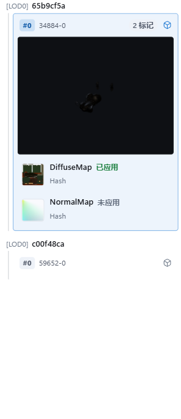

判定只看磁盘：SubMeshJson 里有这条记录，**并且**对应贴图文件真实存在，才显示「已应用」。所以"点了应用还是未应用"通常是：

- **源图缺失**：`DedupedTextures` 里没有这张图，这条被静默跳过，名字还在，于是留在「未应用」，成功提示里的 `count` 也会偏小。
- **名字改过但没再应用**：旧名字那条仍是「已应用」，新名字这条是「未应用」，两条同时出现。
- **复制出去的贴图被删了**：记录还在，文件不在，判定不成立。
- **SubMeshJson 读不出来**（JSON 损坏或缺 `GamePreset`、`IndexBufferList`）：图复制了，JSON 没写进去。

::: tip
这里不做 DDS 转换，不存在"转换失败"。要么源文件找不到（静默跳过），要么复制/写 JSON 抛异常（整次失败，红字提示）。
:::

### 红色「冲突」

同一个 SubMesh 里，两条标记名称**去掉首尾空格、忽略大小写**后相同就都标红；跨 SubMesh 不算。

为什么要管：名字会直接变成文件名 `<SubMesh>-<标记名称>.dds` 和后面的资源名。两幅**不同的图**同名时，MMT 只能补 `-<8 位哈希>` 防止互相覆盖，而 Blender 一步导入是按 `<SubMesh>-<标记名称>.dds` 找图的，补了后缀就找不到；生成模板时资源名还会撞车。

解决办法只有一条：**给其中一幅改名**。同一张去重图在多个 DrawCall 用同一个名字不算冲突，复制出去仍是同一个文件。冲突只标红、不阻止应用——但红着进游戏，问题更难查。

### 「显示渲染为false的贴图」

开关在右侧卡片最上面。`渲染: true/false` 来自它在 `TrianglelistDedupedFileName.json` 里有没有 `FADataDedupedFileName`（这一帧真正用上的数据），没有就是 `false`，也就是这次截帧里它没被真正画出来。

开关**默认是开着的**，一进来看到的是全部贴图；关掉才只留 `渲染: true` 的条目。用途是排查"为什么某张图没被替换"——如果它是 `渲染: false`，很可能游戏里那段压根没用它。被隐藏的条目在应用时依然会一起落地。

### 建议的操作顺序

1. 左侧选一个 SubMesh。
2. 确认数据类型和 3D 预览（第 3 节）。
3. 选 DrawCall，逐张贴图选「标记名称」和「标记风格」。
4. 这个 SubMesh **全部选完**，再点一次「应用 SubMesh 标记」。
5. 回看左侧：是否都变「已应用」、有没有红「冲突」。
6. 之后再改名字或风格，就再应用一次——重复应用安全，它按最新状态整体重写。

::: tip 顺序反了会怎样
先应用、后改名字，名字只进了记忆，磁盘上还是上一版产物，进游戏当然没变化。
:::

### 失败时会看到什么

- 「请先选择 SubMesh」「未检测到当前工作空间文件夹」：还没选 SubMesh，或工作区没定位到。
- 「未匹配到可应用的贴图标记」：一条都没落地——没填名字、源图全缺，或这个 SubMesh 下找不到可写的目标文件夹。
- 「应用贴图标记失败」/「清除当前 SubMesh 的贴图标记失败」：复制或写文件抛异常，红字。
- 「未找到可清理的 SubMeshJson 目标文件」：点清除时一个目标文件夹都没找到，通常意味着这个 SubMesh 的提取结果不完整。

---

## 8. 配置管理与生成 Mod 模板

右侧这一列除了应用/清除，还有两个删除按钮和两个生成按钮：

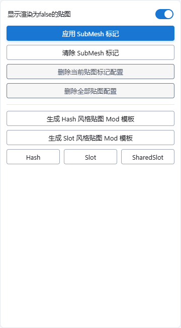

### 两个删除按钮：删的是记忆，不是贴图

「删除当前贴图标记配置」「删除全部贴图配置」是 danger 样式。先和「清除 SubMesh 标记」分开：

| 动作 | 已应用的标记产物 | 配置记忆 |
| --- | --- | --- |
| 清除 SubMesh 标记 | 清（贴图副本进回收站） | 保留 |
| 删除当前贴图标记配置 | 清 | 删掉这个 SubMesh 的全部条目 |
| 删除全部贴图配置 | 清（当前工作区所有 LOD、所有 SubMesh） | 删掉当前游戏全部 |

「清除」之后标记名还在，还能再点一次应用；「删除」之后这些名字就真没了，再点生成只有 0 项——第 5、6 节填的名称和风格全部重来。


::: warning 不可撤销，先看清再点
确认框原文：「该操作不可撤销，请谨慎操作」。贴图和整份 JSON 会进回收站，但被删的条目大多是 JSON **内部**就地改写的，回收站里不一定有旧版本。别把回收站当撤销键。
:::

三个动作都不碰：`DedupedTextures` 里的原始贴图、工作区提取产物、`MMTGeneratedMod` 里已经生成的模板。

### 生成 Hash 风格贴图 Mod 模板

它读整个 SubMesh 全部 DrawCall 的标记（和「应用 SubMesh 标记」同一口径），只挑风格为 Hash 的项，把图从 `<工作区>\DedupedTextures\` 拷出来。**不要求先点应用**，但标记名得还在——上一步删了配置就没得导。

产物目录：`<游戏 3Dmigoto 目录>\<Mods 根>\MMTGeneratedMod\<工作区名>\`，MMT 自己建好并弹出窗口。里面是：

- `<DrawIB>_TextureMod.ini`
- 每张图一个 `<标记名>_<去重贴图文件名>`，例如 `DiffuseMap_6339b684_6339b684-BC7_UNORM_SRGB.dds`

成功提示会报数：

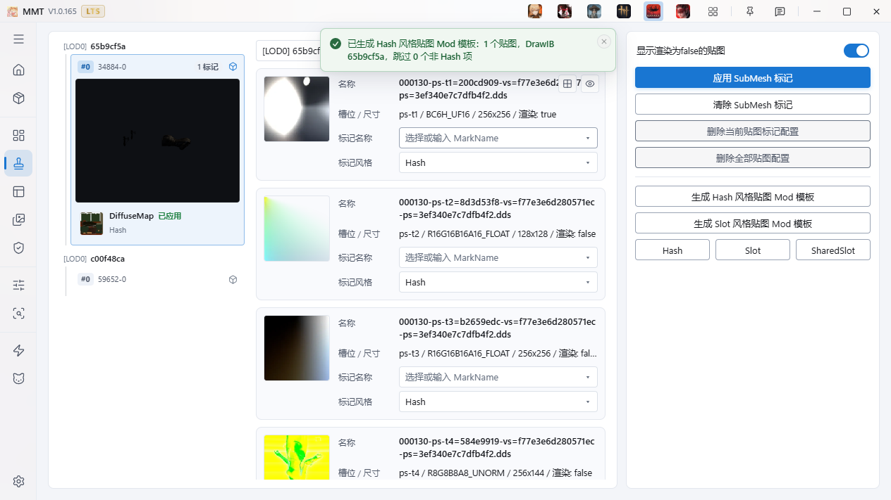

`已生成 Hash 风格贴图 Mod 模板：1 个贴图，DrawIB 65b9cf5a，跳过 0 个非 Hash 项`——"跳过"就是风格不对的项。

ini 里先一个 `[TextureOverride_IB_SlotCheck]`（`hash = <DrawIB>`、`match_priority = 0`）挂若干 `checktextureoverride = <像素槽位>`，再逐图给一对 `[TextureOverride_Texture_<贴图 hash>]` / `[ResourceTexture_<贴图 hash>]`（ZZMI / ZZMIDX12 不出这些行，改插 `run = CommandListSkinTexture`）。

会遇到的提示：「未能从当前 SubMesh 解析 DrawIB」「无法创建或解析生成 Mod 文件夹路径」「当前 SubMesh 下没有可导出的 Hash 风格贴图标记」，失败则是「生成 Hash 风格贴图 Mod 模板失败」。

### 生成 Slot 风格贴图 Mod 模板

同理，只收 Slot / SharedSlot。多一道硬要求：SubMesh 名得是 `<hash>-<IndexCount>-<FirstIndex>` 三段，拆不出来就提示「当前 SubMesh 名称无法解析出 Slot 模板所需的 Hash 和索引信息」，什么都不会生成。

产物同目录：`<SubMesh>_SlotTextureMod.ini`，加每张图 `<hash>-<IndexCount>-<FirstIndex>-<标记名>.<后缀>`。ini 段是 `[TextureOverride_<hash>_<IC>_<FI>]`（`hash` / `match_first_index` / `match_index_count`），资源段 `[Resource-<hash>-<FI>-<标记名>]`。GIMI 按标记名换成语义槽位并调 `CommandList\GIMI\SetTextures`，EFMI 插 `run = CommandList\EFMIv1\OverrideTextures`，其它预设用物理像素槽位。

同一个子网格里两条标记压到同一个 `ps-tN` 时，非 GIMI 预设是**静默丢掉后一条**（不报错，导出数量少一个），GIMI 的语义槽位撞车才会直接报冲突。

两个生成按钮互斥：一边生成时另一边禁用；应用/清除/批量改风格时两个都禁用。两种都试就分两次点。

### 生成完了怎么用

1. 目录已经在 Mods 根下（MMT 按 `d3dx.ini` 的 `include_recursive` 解析，GIMI 是 `Stuffs`，别的预设可能是 `Mods`，以本机为准），一般不用手动搬。
2. 要挪就整包挪：ini 和所有 dds 保持同级同目录。
3. 重启游戏让 3Dmigoto 重新读 ini，再看效果（3Dmigoto 只在启动时读 ini）。

第 6 节那句：**hash 认图、slot 认位置**。Hash 模板认贴图 hash，换个模型也认；Slot 模板认 DrawIB 加索引区间，认的是"这个位置"，换个模型版本就可能对不上。

没生效就按顺序查三件：

- **ini 有没有被读到**：文件夹在不在 Mods 根下、`include_recursive` 指到没有、游戏重启没有。
- **贴图有没有被别的 Mod 抢**：同一个 hash 两个 Mod，后加载的赢；先临时移走其它贴图 Mod 再试。
- **hash/slot 跟游戏版本对不对**：游戏一更新，DrawIB 和索引区间就会变，得重新提取、重新生成。

### 和 Blender 导入的配合

MIMIBlender 一键导入时按 `<SubMesh>-<MarkName>.dds` 这个名字去 SubMesh 文件夹里找图。顺序只有一种：**先标记、应用，后导入**；反过来做，导入器找不到图，只给你一个没材质的空壳。

同一个 SubMesh 里一个 MarkName 落到两张不同的图时，MMT 会给文件名加 `-<8 位十六进制>` 后缀防覆盖，导入端只在能唯一确定时才认。导入后贴图错位或干脆没材质，回来查这三样：

- SubMesh 文件夹里到底有没有 `<SubMesh>-<MarkName>.dds`（没点过应用就没有）；
- 同一个 MarkName 是不是被两张图占用了（看有没有那个 8 位后缀）；
- 是不是先导入后标记的——补标记、再应用、重新导入。

别混：Blender 吃的是工作区「应用」出的副本，不是生成模板。

### 收尾清单

- [ ] 提取完成，SubMesh 列表里能看到目标 SubMesh
- [ ] 预览形状正常、UV 不炸，数据类型选对（第 3 节）
- [ ] 每张要换的图都填了 MarkName，风格选好（第 5、6 节）
- [ ] 点过「应用 SubMesh 标记」，文件夹里有对应 dds
- [ ] 生成前没手滑点两个删除按钮（配置记忆还在）
- [ ] 只挑一种风格生成，提示里的数量对得上
- [ ] `MMTGeneratedMod\<工作区名>` 里 ini 与 dds 齐全同级
- [ ] 文件夹在游戏真正扫描的 Mods 根下
- [ ] 重启游戏，看到新贴图
- [ ] 没生效：按 ini 读取 → 被覆盖 → 版本匹配逐项排除

### 常见失败原因

| 症状 | 可能原因 | 怎么办 |
| --- | --- | --- |
| 提示「没有可导出的 Hash/Slot 风格贴图标记」 | 风格不对（Hash 只收 Hash，Slot 只收 Slot/SharedSlot），或图不在 `DedupedTextures` | 回第 6 节改风格，重新应用再生成 |
| 提示「未能从当前 SubMesh 解析 DrawIB」 | 提取结果不完整，解析不出 DrawIB | 重新完整提取这个 SubMesh |
| 提示「无法解析出 Slot 模板所需的 Hash 和索引信息」 | SubMesh 名不是三段式 | 用正常提取出来的 SubMesh，别手改文件夹名 |
| 生成成功，游戏里没变化 | ini 没被读到（不在扫描目录、没重启），或被别的 Mod 覆盖 | 确认 Mods 根与 `include_recursive`、重启；再临时移走其它贴图 Mod |
| 生效过，游戏更新后失效 | DrawIB、IndexCount/FirstIndex 随版本变了 | 重新提取、重新生成模板 |
