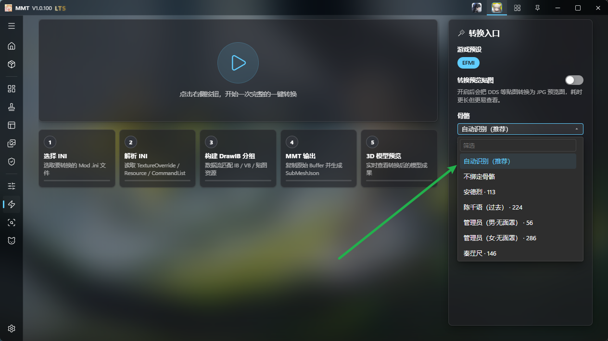
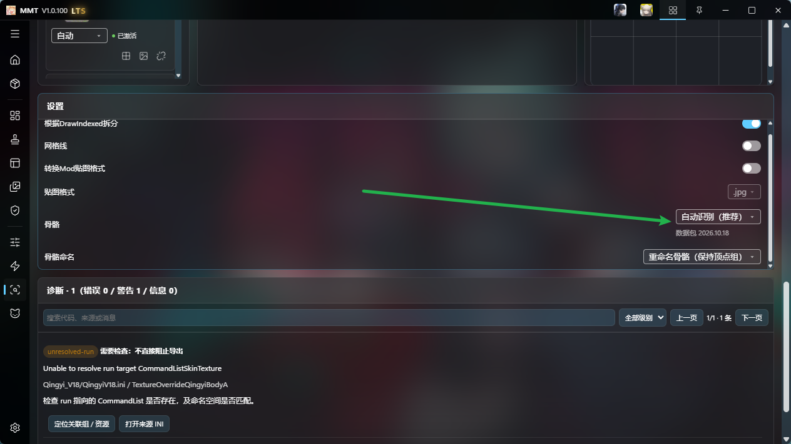
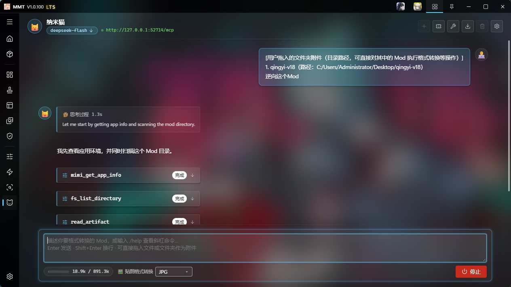
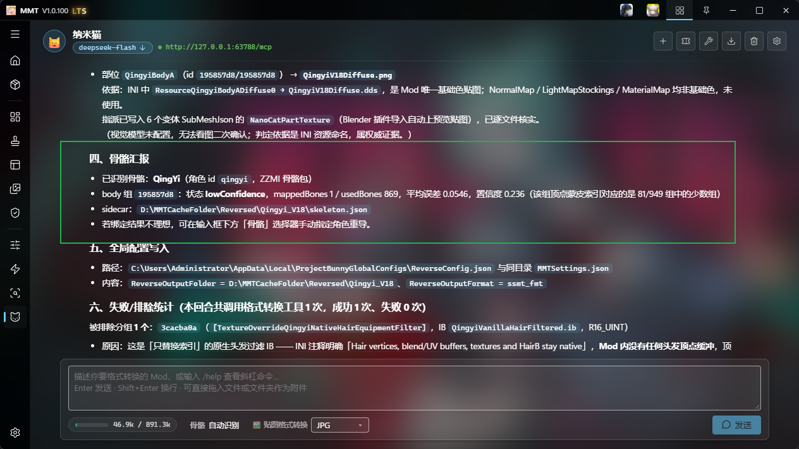
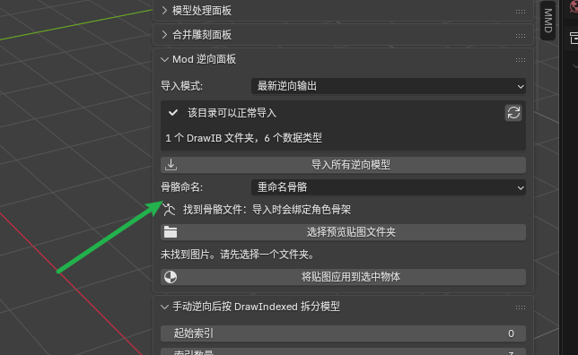
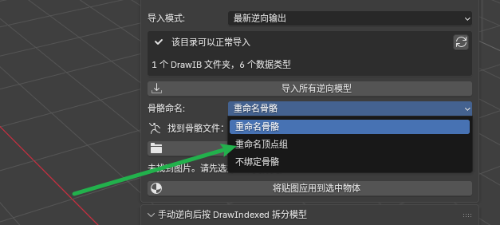
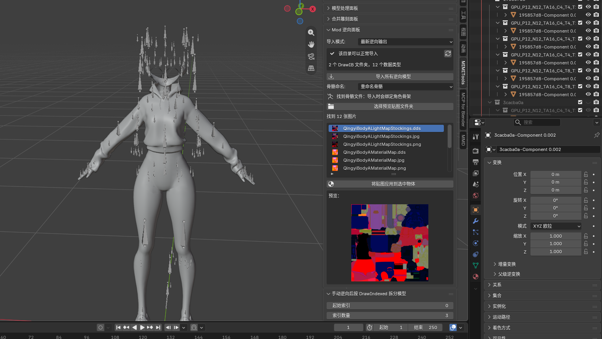

# 逆向出来自带骨骼

在MMT V1.0.101或更高版本中，现在：
- GIMI 原神
- HIMI 崩坏三
- SRMI 崩坏:星穹铁道
- ZZMI 绝区零
- WWMI 鸣潮
- EFMI 明日方舟:终末地

等游戏预设，逆向出来的Mod可以自带骨骼了

Blender版本最低要MIMIIBlender V1.0.53才能适配此功能，使用前记得把MMT本体和Blender插件都更新到最新版即可

## 一键逆向
如图：

一键逆向中可以自动识别对应角色的骨骼，也可以手动选（如果自动识别有问题可以自己手动选，百分之99的情况下自动识别算法都是很准确的，除非MMT根本就没有对应的骨骼存在，这种情况下可能会乱匹配一个）

## Mod分析

Mod分析页面下滑也有骨骼选项，推荐用自动分析，也可以手动选

## 纳米猫AI自动逆向

纳米猫最狠，骨骼识别精度最高，AI全自动识别对应骨骼

## Blender中导入选项

这里默认选中重命名骨骼，默认你的目的是用来修改Mod

如果你是薅出模型来做其它用途，可以选择重命名顶点组：

## 最终效果

骨骼应该能够正确绑定到逆向出来的模型上

如果游戏版本更新后，缺少对应角色的骨骼，可以反馈给我补上

或者你们逆向Mod的过程中遇到GPU数据类型但是缺少骨骼的，比如MMT没有内置骨骼的话，可以联系我添加。

## 总结

MMT正式进入 Mod模型 = 带骨骼的模型资产时代

任何人的模型提取出来，就能直接拿来用，相比以前没有骨骼的时代更加方便好用。

所有Mod逆向里最强的仍然是纳米猫，有条件尽量用纳米猫

